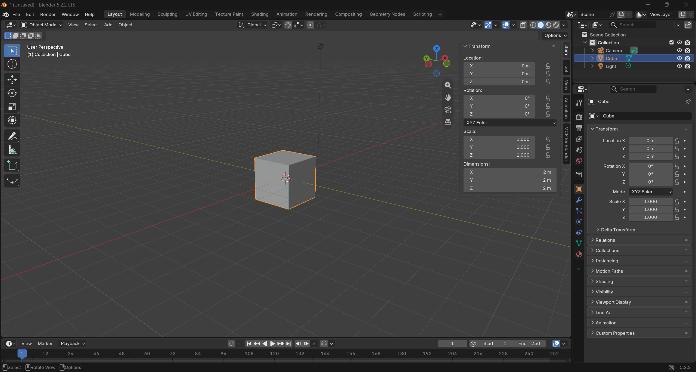

# BLENDER-NOTES — Learn the window (Assignment 3)

Written by me, in my own words, after a short look-only session in Blender 5.2.2 LTS on Windows 11, before asking Claude to build anything. Reference: the Blender manual's [interface chapter](https://docs.blender.org/manual/en/5.1/interface/index.html) and [3D viewport pages](https://docs.blender.org/manual/en/5.1/editors/3dview/index.html).

Date and time of the session: 10/15/2026, 18:20

## Screenshot

*My own screenshot, not a reconstruction. What is selected: The default Cube seen after opening the blender*

## 1. 3D viewport

A cube with each lines with 2 square length. It imitates the shadow we see in the real life by changing the brightness of sides; the more area we see, the brighter it looks. I can also see red lines acrossing as X axis and green lines acrossing representing Y axis.

## 2. Toolbar

Clicking the move creates green lines surrending the cube, and I can also see the current 3 axis that help record the position of the cube. Rotate shows a sphere instead.

## 3. Outliner

The list of every object at top right. I can easily select the exact parts of generated objects.

## 4. Properties editor

The column of tabs at bottom right. Tabs show properties of the cube like positions, color, and layer.

## 5. Sidebar (N)

Can be opened by typing "N", with tabs: location, rotation, scale and dimensions. I can use Dimensions to check asset sizes.

## 6. Mode selector (Object Mode / Edit Mode)

Object Mode moves whole objects; Edit Mode moves the points, edges and faces inside one object. I used Edit Mode to adjust the position of the bow.

## Navigating the viewport (orbit, pan, zoom)

I can use the middle mouse buttons with keys like "SHIFT" to orbit, pan and zoom. The axis gizmo at the top right.
