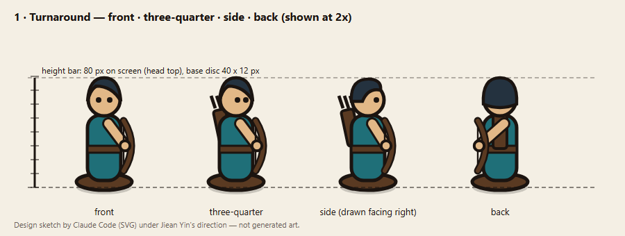
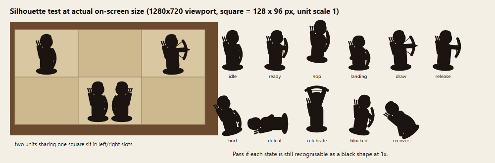
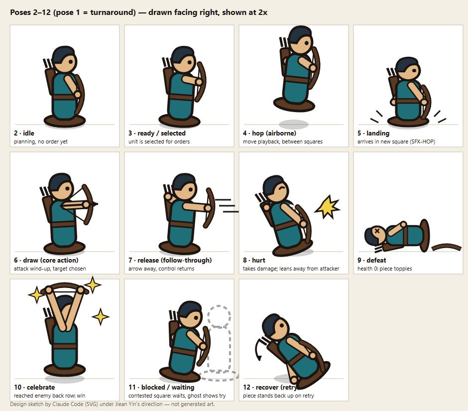
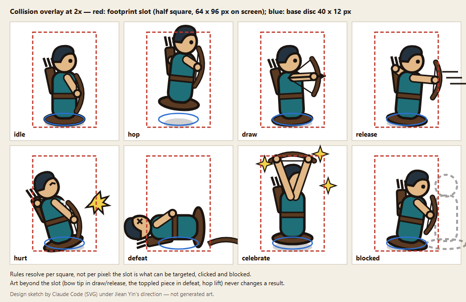
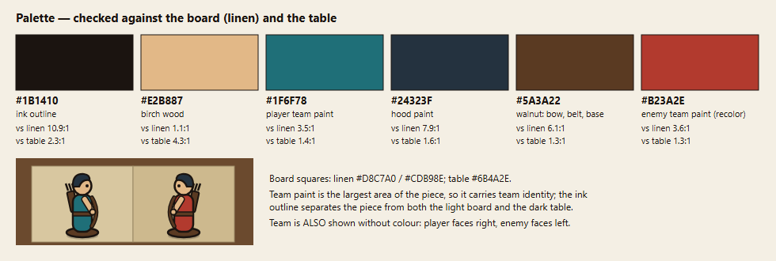

# Character sheet — the Archer (main controllable piece)

*Version 1, 2026-10-09, before any asset was generated. This sheet is the contract that generated images are judged against.* All images in `design/character/` are design sketches drawn by Claude Code as SVG under Jiean Yin's direction ([design/tools/draw_sketches.py](design/tools/draw_sketches.py)). They are not generated art. Each SVG has a PNG copy rendered at the same pixel size.

- **Concept in one sentence:** a carved and painted wooden archer piece (ball head, dark hood, cylinder body in team paint, walnut bow, quiver and disc base) that hops between squares and shoots across lanes.
- **Why the archer:** one humanoid figure is the most consistent subject for image models; a rider and horse at small size is the hardest. Its core action (shoot) has a clear wind-up and follow-through. Riders and shielders get their own sheets later in the semester.
- **On-screen size:** viewport 1280 × 720; one board square is 128 × 96 px; the piece is about **80 px tall** with a **40 × 12 px** base disc (scale 1). Two pieces in one square stand in left and right slots.

## Reference — pose 1: turnaround

Front, three-quarter, side and back at the same height, with a height bar. Every later pose and every generated image is checked against this.

## Silhouette test (at actual on-screen size)

Black-filled pieces at scale 1 on 1:1 board squares, plus every pose's silhouette at 1×. **Pass condition:** each state is recognisable as a black shape at 1×. **Result on the sketches:** hurt, defeat, celebrate, draw and hop pass. *Idle, ready, landing and blocked* are nearly the same black shape; they differ only in bow height and squash. In play these states are never told apart by the pose alone: selection has a yellow square outline, landing has the sound and motion, and blocked has the ghost marker. That is why the slice generates only states whose silhouettes differ.

## Orientation

- **Drawn and generated facing right** (side profile) only.
- **Flipped at runtime:** horizontal flip for facing left. Player pieces face right by default and enemy pieces face left. A piece turns to face its move or attack direction; for vertical-only moves it keeps its last facing.
- **Never generated:** front or back views for gameplay. The turnaround is a reference for proportions only, because the game camera always sees pieces in profile.

## Poses (12; each a static image for one game state)

| # | Pose | Game state | In the asset slice? |
|---|---|---|---|
| 1 | Turnaround | reference only | sheet only |
| 2 | Idle | planning, no order yet | **generate (CHAR-IDLE)** |
| 3 | Ready / selected | piece selected for orders | sheet only (idle + yellow outline in the slice) |
| 4 | Hop (airborne) | between squares in move playback | optional (CHAR-HOP); otherwise idle lifted in code |
| 5 | Landing | arrives in a new square (SFX-HOP) | sheet only |
| 6 | Draw | attack wind-up (core action) | **generate (CHAR-DRAW)** |
| 7 | Release | follow-through; control returns | optional |
| 8 | Hurt | took damage; leans away from the attacker | **generate (CHAR-HURT)** |
| 9 | Defeat | HP 0; the piece topples | **generate (CHAR-DEFEAT)** |
| 10 | Celebrate | reached the enemy back row | **generate (CHAR-WIN)** |
| 11 | Blocked / waiting | contested square; a ghost shows the attempt | later milestone |
| 12 | Recover | stands back up on retry | optional |

The enemy uses the **same images recoloured** (team paint teal → red, a logged edit) and flipped to face left.

## Collision overlay

- **Red dashed box, the footprint slot:** half a square, 64 × 96 px on screen. Lane Tactics resolves rules **per square, not per pixel**, so this slot is what can be selected, targeted, blocked and counted.
- **Blue ellipse, the base disc:** 40 × 12 px. Every image is anchored here: the disc centre is the piece's position, so all poses line up on the same spot.
- **Art beyond the slot, and why that is fair:** the bow tip in draw/release, the toppled body in defeat, and the hop lift all leave the slot. None of it can be hit or block anything; results come only from which square the piece is in, so stray pixels never change an outcome. F3 shows the real slot in the game (display only).

## Palette

| Role | Hex |
|---|---|
| Ink outline, eye, bowstring | `#1B1410` |
| Birch wood (head, hands) | `#E2B887` |
| Player team paint (tunic) | `#1F6F78` |
| Hood paint | `#24323F` |
| Walnut (bow, belt, quiver, base) | `#5A3A22` |
| Enemy team paint (recolour) | `#B23A2E` |

**Environment check:** board squares are linen `#D8C7A0` / `#CDB98E`; the table beyond the board is `#6B4A2E`.
- Team paint vs linen: teal **3.5 : 1** and red **3.6 : 1** (contrast ratio).
- The ink outline separates the piece from the table (2.3 : 1). Teal vs the table is only 1.4 : 1, but pieces never stand on the table, only on the board.
- **Weak spot:** birch wood vs linen is only **1.1 : 1**. The head and hands disappear into the board without the ink outline, so rule 3 below (the outline) is not optional, and a generated image without a clear outline is rejected.
- Team identity is also carried by facing, so it survives colour-blindness and greyscale.

## Consistency rules (judge every generated image against these)

1. **Proportions:** total height ≈ 3.5 heads; the head is a ball about ¼ of the height; the body is one straight cylinder with no legs; the **base disc is always visible** and as wide as the body plus a margin on each side.
2. **Eye:** one dark dot eye on the facing side at the head's centre height. No mouth, no nose, no other facial features.
3. **Outline:** one thick, even dark outline (about 2–3 px at 1×) around every shape. No soft airbrushed edges.
4. **Silhouette:** hood, quiver on the back and bow in front are always present, so the archer reads as an archer in black.
5. **Paint:** flat colour areas in the palette above. Team paint covers the tunic only; wood stays wood-coloured; no gradients beyond a soft lamp shadow.
6. **View:** side profile facing right. Generated with a solid background colour (not "transparent") so the background can be removed cleanly.
7. **Same piece:** every pose is derived from one accepted reference image (CHAR-REF), not from re-running the text prompt.

## Revisions

*(none yet)*
