# Lane Tactics — Game Design Document

*Draft 3, 2026-10-19. Gathers the existing design docs into one document, with the campaign additions decided on 2026-10-19: goblin enemies, mountains, night raids, the Mend ability and the giant boss. [RULES.md](RULES.md) stays the source of truth for rules; how each decision was made is in [DESIGN-HISTORY.md](DESIGN-HISTORY.md) section 8.*

| Label | Meaning |
|---|---|
| **Built** | in the playable Godot slice (Assignment 2) or the 3D diorama (Assignment 3) |
| **Agreed** | in [RULES.md](RULES.md), confirmed by Jiean; not built yet unless also marked Built |
| **Later** | agreed in outline; details or numbers left for later ([§12](#12-open-decisions)) |

## 1. Name of the game

**Lane Tactics** (working title).

## 2. Concept

You command a small army of carved wooden pieces on a five-lane tabletop board against an AI general and its goblin army. The general gives its orders at the same moment you give yours. Each turn you decide where every piece steps and what it strikes; then both plans play out together, and the first side to stand a piece on the enemy's back row wins.

- **Genre:** turn-based tactics with simultaneous orders, single player against an AI.
- **View:** fixed high camera over a 5 × 8 board; pieces stand upright in profile. Lanes run horizontally like Plants vs Zombies; pieces move one square in 8 directions, like chess kings.
- **Units:** three types that counter each other. Shielders block arrows, riders break shielder lines, and archers punish riders.
- **Campaign:** four episodes, and each one adds a challenge from the environment: open field, hills, a night raid, and a giant.
- **Platform:** desktop (Windows tested), keyboard.

**Design pillars** (from [CONCEPT.md](CONCEPT.md)):

| Pillar | What it means |
|---|---|
| 1. Read the board at a glance | Team, unit type and state are clear in one look, even with the sound off. |
| 2. Plans collide | The tension is the reveal: two hidden plans meeting at once. |
| 3. Every piece has weight | It should feel like moving real pieces on a real table. |
| 4. Fair, readable consequences | When you lose a piece, you can see why and who did it. |

## 3. Game flow

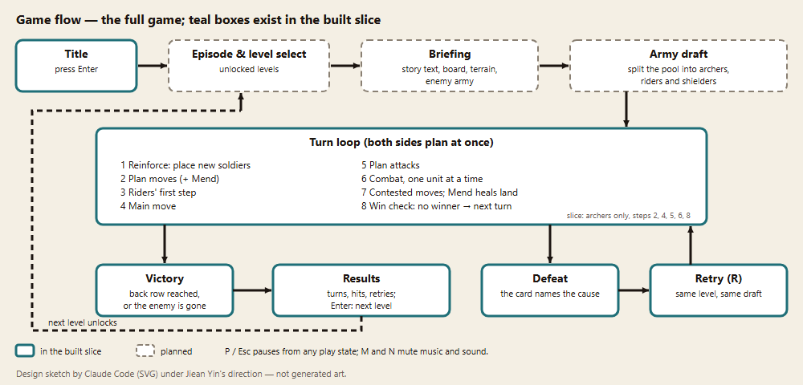

**One level, from start to end.** Title → episode and level select → briefing (story text, the board, its terrain and the enemy army) → army draft (split the soldier pool into archers, riders and shielders) → the turn loop until someone wins → victory and results (the next level unlocks) or defeat (the card names the cause) → retry.

**One turn** (8 steps, [RULES.md](RULES.md) "Turn sequence"): reinforce → plan moves (and Mend) → riders' first step → main move → plan attacks → combat, one unit at a time → contested moves (and Mend heals land) → win check. Night levels add the alarm check after the main move and the alarm spread before the win check.

**One session of the built slice**, shot by shot, is in [STORYBOARD.md](STORYBOARD.md):

| Title | Board at start | Move | Hit |
|---|---|---|---|
|  |  |  |  |
| **Defeat** | **Retry** | **Win** | **Results** |
|  |  |  |  |

## 4. Game elements and assets

**Board elements**

| Element | What it does | Status |
|---|---|---|
| Board, 5 lanes × 8 columns | A square holds at most 2 units; each side's back row is its edge column | Agreed; Built |
| Soldier pool | 12 soldiers per side, split among the three types before the match | Agreed |
| Reinforcements | 2 new soldiers per turn, placed on your own back row | Agreed |
| Mountain squares | Bonuses for the unit standing there; entering one ends a move (§7.3) | Agreed |
| Night mist | Squares stay dark until your units have been near them; enemies sleep or patrol until alarmed (§7.4) | Agreed |
| Giant boss | Arrives as an enemy reinforcement on a later turn, walks 1 square per turn, pushes everything in front of it (§7.4) | Agreed; numbers Later |
| Readability markers | Order numbers during attack planning, planned-move arrows, contested-move shadows, red charge squares, friendly-fire warning, target marker, HP pips; at night, danger zones and patrol arrows; the Mend glow; the giant's push square and a warning on any unit it would destroy | Agreed (move marker, target marker and HP pips Built) |

**Assets in the project** (every source, prompt and edit is in [SOURCES.md](SOURCES.md)):

| Kind | Asset | Made with | Status |
|---|---|---|---|
| Character art | Archer: idle, draw, hurt, defeat, win; red enemy copies (`godot/assets/art/`) | Stable Diffusion XL, run locally, then edited | Built |
| Environment | Warm-lit walnut tabletop (`env_table.png`); the linen board is drawn in code | SDXL | Built |
| Sound effects | SFX-HOP, SFX-HIT, SFX-HURT, SFX-WIN (`godot/assets/sfx/`) | ElevenLabs Sound Effects | Built |
| Music | MUS-LOOP, a 24-second loop (`godot/assets/music/`) | MusicGen small, run locally | Built |
| 3D models | `archer_piece`, `board_square`, `goal_flag` (`godot/assets/models/`), in `godot/diorama/asset_diorama.tscn` | Blender through the Blender MCP | Built (not connected to the 2D game) |
| UI | HUD, markers, cards, arrow projectile | Code | Built |
| Still to make | Rider and shielder art; the goblin army (one goblin head across three pieces); mountain tile; night mist; the giant; new sounds and music (§9) | — | Planned |

## 5. Main characters

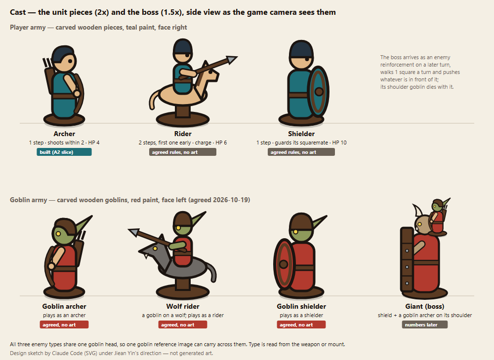

The player's army is carved wooden pieces in teal paint, facing right. The enemy army is carved wooden **goblins** in red paint, facing left. Each goblin plays exactly like the matching player type, so one rule set covers both armies. All three goblins share one head design (long ear, leather cap, yellow eye), so one accepted goblin reference image can carry across them. Their type is read from the weapon or mount: bow, wolf and spear, or shield.

| Player piece | Enemy counterpart | Movement | Attack | Strikes back | HP · damage (first guesses) |
|---|---|---|---|---|---|
| **Archer**, the main character. Full sheet: [CHARACTER-SHEET.md](CHARACTER-SHEET.md) | **Goblin archer** | 1 square | Any of the 24 squares within two steps; hits every unit in the square, allies too | Never | 4 · 3 |
| **Rider**, a fast flanker on a carved horse | **Wolf rider**, a goblin on a wolf | 2 steps, the first before other units move | Adjacent; charge bonus after 2 steps in the same direction | Yes | 6 · 3 (+2 charge) |
| **Shielder**, high health, big round shield | **Goblin shielder** | 1 square | Adjacent, low damage | Yes | 10 · 2; it takes half from arrows; its squaremate takes 0 (half once the shielder is at or below half health) |
| — | **Giant (boss)**, with a tower shield and a goblin archer on its shoulder; the goblin dies with the giant | 1 square per turn along its lane; cannot be blocked | Hits and pushes back every unit in the square in front before it moves; its goblin shoots like a goblin archer | Yes, against its push hit | Later |

Only the archer has a full character sheet (turnaround, 12 poses, silhouette test, collision overlay, palette). Each new piece needs the same before its art is generated: a reference image and about 4–5 poses (idle, attack, hurt, defeat, win). Turn-based play means no walk cycles; pieces hop between squares and only face left or right.

## 6. Story

*Jiean's outline; the text was drafted by Claude from it and edited by Jiean (2026-10-19).*

**Premise.** You are the commander of the human army. A goblin horde is invading the human settlement, and every attack it makes is harder than the last. You hold them back on the open fields, then in the hills. Then, you turn defence into attack with a raid on their camp at night. In their last effort, the goblins send an unstoppable giant to break your line in one shot.

The story is told one episode at a time: a short briefing before each episode, a line before each level, and a closing line after the episode's last victory. Every text fits on the briefing card, so the story never slows the game down. In keeping with the art direction, it stays calm and a little worn, "not glossy plastic or fantasy-epic".

| Episode | Story beat | What you do | Why the challenge fits the story |
|---|---|---|---|
| 1 · Open Field | The invasion begins | Defend | The goblins test your line with scouts, then wolves, then a shield wall |
| 2 · The Hills | The war gets harder | Defend on rough ground | The goblins take the high ground to break through, so the hills matter to both sides |
| 3 · Night Raid | You strike back | Attack | A surprise attack only works if you aren't seen: mist, sleeping camps and patrols |
| 4 · The Giant | The goblins' last effort | Survive and destroy | Something you can't stop must be killed before it reaches your line |

### Episode 1 · Open Field

> **Briefing.** Smoke rises from fields further away. Goblin scouts have crossed the border, and behind them the whole horde is coming. You are the commander of the border guard. Hold the fields, and don't let a single goblin reach our line.

| Level | Before the level |
|---|---|
| 1-1 First Shot | "A lone goblin archer is scouting our defences. Send an archer out to meet it." |
| 1-2 Wolves | "They've brought wolves. Wolf riders are fast and strike first. Answer them with riders of our own." |
| 1-3 Shield Wall | "The goblins have learned to hide behind shields. Arrows alone won't break that wall." |

> **After the episode.** The fields hold. But the scouts that escaped will tell the horde where our line is weak.

### Episode 2 · The Hills

> **Briefing.** Beaten on open ground, the goblins turn their attack toward the hills. Whoever holds a hilltop sees further, shoots further and charges harder. Take the heights before they do.

| Level | Before the level |
|---|---|
| 2-1 One Hill | "One hill stands between the armies. Whoever holds it holds the valley." |
| 2-2 Twin Peaks | "Two peaks, and goblins climbing both. Split your army or win one hill at a time." |

> **After the episode.** The hills are ours, and from the top we can see their camp fires. As long as we only defend, they will keep coming. Maybe it's time for us to strike back.

### Episode 3 · Night Raid

> **Briefing.** Tonight we raid the goblin camp. Move quietly. You can only see what your soldiers have scouted, and every goblin you wake will wake the ones around it. Strike before the camp is ready.

| Level | Before the level |
|---|---|
| 3-1 Sleeping Camp | "The camp is asleep. Get through before the alarm spreads." |
| 3-2 Patrols and Hills | "Sentries walk the same paths every night. Learn their routes, and use the hills to watch them." |

> **After the episode.** The raid breaks the horde's spirit. But deep in the camp, something huge is waking up.

### Episode 4 · The Giant

> **Briefing.** The goblins have one card left: a giant, with a goblin archer riding on its shoulder. It can't be stopped, only killed. It will walk straight at our line and crush whatever stands in its way. Gather everything we have, and bring it down before it reaches us.

| Level | Before the level |
|---|---|
| 4-1 The Giant | "It's coming. Get out of its path, or make sure there is room behind you." |

> **After the episode.** The giant falls, and the horde breaks and escapes away. The border is safe, at least for now.

## 7. Gameplay

### 7.1 Goal: why play

- **Out-think the other side.** Every turn ends with a reveal: both plans play out together, and you see whether you read the enemy correctly and made the best decision.
- **Short, readable matches.** One clear goal (a piece on the enemy back row), a small board and few pieces, so a match fits in a short session and every loss shows its cause.
- **Master the counters.** Archers, riders and shielders beat each other in a loop. Hills and the night change which one is strongest where.
- **Progress through episodes.** Each episode adds one challenge from the environment and ends with the giant.

### 7.2 Game mechanics: what the player does

Every action is an order given during planning (full rules: [RULES.md](RULES.md)):

| Phase | Player action |
|---|---|
| Before the match | Split the soldier pool among archers, riders and shielders |
| Reinforce | Choose the types of this turn's new soldiers and place them on free back-row squares |
| Plan moves | For each unit: stay, or step 1 square in any of 8 directions (riders plan 2 steps, 3 from a mountain). Units without an order stay. Plus at most one Mend |
| Plan attacks | For each unit with an enemy in reach, choose the target square (picked automatically when only one is valid) |
| Watch | Moves, then attacks, play out one unit at a time; the sides take turns, and which side strikes first switches every turn |

**Controls** (keyboard, built in the slice):

| Key | Action |
|---|---|
| Enter | start; confirm the order; play again |
| Arrow keys / WASD | move phase: choose a neighbouring square · attack phase: cycle the valid targets |
| Space | stay (move) or hold fire (attack) |
| R | retry from turn 1 |
| P / Esc | pause and unpause |
| M / N | mute and unmute music / sound effects |

### 7.3 Abilities and power-ups

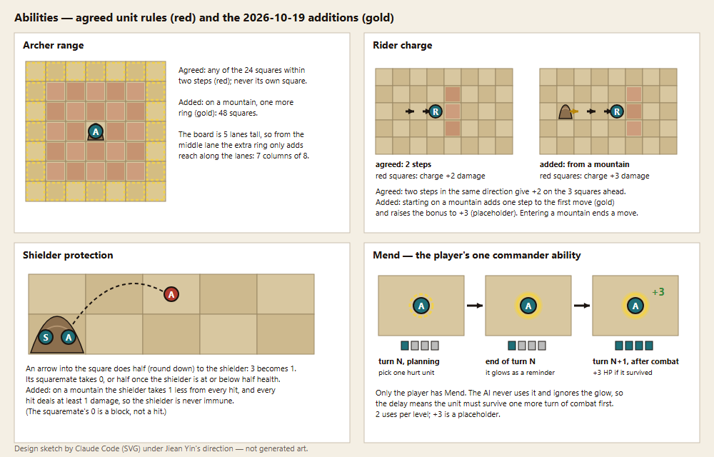

**Unit abilities (Agreed):**

- **Archer range:** any of the 24 squares within two steps, never its own square. Arrows hit every unit in the target square, including your own.
- **Rider first step and charge:** riders move before everyone else; two steps in the same direction give +2 damage on the 3 squares ahead (shown red). The second step is cancelled if an enemy is in or next to the rider after the first.
- **Strike back:** riders and shielders hit back every time an adjacent enemy hits them; at half health or below the strike back is reduced.
- **Shielder protection:** the shielder takes half damage from arrows. Its squaremate takes none while the shielder is above half health, and half once the shielder is at or below half health. A worn-down shield lets arrows through, which also makes the shielder a good target for Mend.
- **Minimum damage:** every hit deals at least 1 damage after all reductions, so no unit is ever immune. The one exception is the squaremate of a shielder above half health: that is a block, not a reduced hit.

**Mountain bonuses (Agreed).** Entering a mountain ends that unit's move. Then:

| Unit | Bonus |
|---|---|
| Archer on a mountain | one more ring of range: 48 squares instead of 24 |
| Rider that starts the turn on a mountain | one more step in its first move (three in all); +3 charge instead of +2 when all three go in one direction |
| Shielder on a mountain | takes 1 less damage from every hit, never below 1 |
| Any unit on a mountain, at night | sees one square further |

Both sides get the same bonuses, and mountains are placed in mirror pairs.

**Mend: the player's one commander ability (Agreed; Jiean's idea, first called "Reinforcement").**

- During move planning, pick one friendly unit. At the end of the turn it glows, as a reminder.
- After combat on the next turn, it heals +3 HP (never above its maximum) if it is still alive.
- 2 uses per level, from Episode 2 on.
- The AI never uses Mend and does not react to the glow. It is a deliberate edge for the human player, like the rule that ties go to the player.

**Power-ups:** none. There are no pickups or random bonuses, because a random swing hides why you lost (pillar 4). Mountains and Mend are the only extras, and both are shown on the board.

### 7.4 Levels and challenges

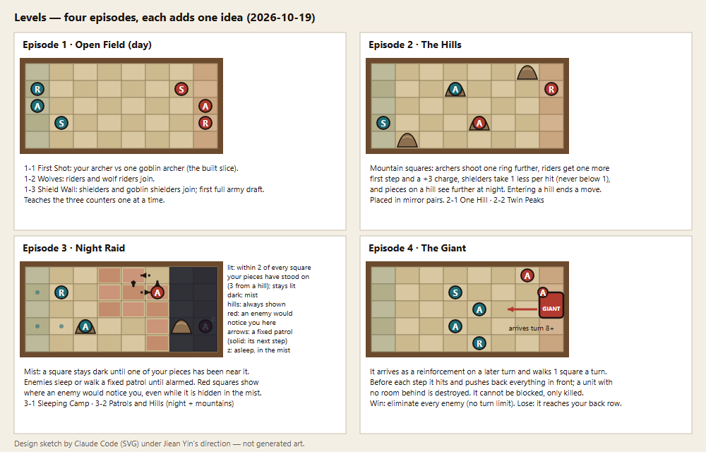

| Episode | Level | New idea | Challenge |
|---|---|---|---|
| **1 · Open Field** (day) | 1-1 First Shot | Your archer vs one goblin archer (the built slice) | Timing: step into range on the turns you shoot first |
| | 1-2 Wolves | Riders and wolf riders | The rider's early first step and the charge squares |
| | 1-3 Shield Wall | Shielders and goblin shielders; first full army draft | All three counters at once; friendly fire |
| **2 · The Hills** | 2-1 One Hill | One pair of mountains; Mend becomes available | Taking a hill and holding it |
| | 2-2 Twin Peaks | Several mountain pairs | Fighting from and around several hills |
| **3 · Night Raid** | 3-1 Sleeping Camp | Mist; sleeping enemies | Sneak in, or strike before the camp wakes |
| | 3-2 Patrols and Hills | Patrol routes; mountains to see from | Reading patrol routes and scouting from the hills |
| **4 · The Giant** | 4-1 The Giant | The giant arrives as an enemy reinforcement on a later turn and cannot be stopped | Gather and push up the lanes in the early turns, keep out of the giant's lane or make room behind you, and kill it within 7 turns of its arrival |

**Night raids (Agreed).** Night works like the mist in Civilization-style games: you explore to see what is behind it.

- **Mist:** a square stays dark until one of your units has stood within 2 squares of it (3 from a mountain). Once revealed it stays revealed, and you see everything on it as it happens. Mountains are always shown, because they are high.
- **Enemies:** each one starts **sleeping** (it stays put) or **patrolling** (it walks a fixed route, one step per turn, shown with an arrow). Once **alarmed**, it plays normally.
- **Danger zones:** every enemy's attack range is shown in red on revealed squares, even while the enemy itself is hidden in the mist. This is what makes sneaking possible. Your sight (2) equals a goblin archer's range (2), so without the zones you would only see a goblin once you were already inside its range.
- **Alarm:** an enemy is alarmed when one of your units is inside its attack range after the moves, or attacks it. A newly alarmed enemy attacks from the next turn, so a raid earns the first strike. At the end of each turn, every alarmed enemy alarms patrolling enemies within 2 squares and sleeping enemies within 1 square.
- **Fairness:** any enemy that attacks one of your units reveals its square, so you always see who hit you (pillar 4). The AI sees the whole board.

**The giant (Agreed; numbers Later).**

- **Arrival:** the giant enters on the enemy back row as a reinforcement on a later turn. That gives you time to gather your army and get close to the end of the lanes first.
- **Size:** the giant and the goblin archer on its shoulder fill one square. The goblin shoots like a goblin archer and dies with the giant.
- **Unstoppable:** every turn it moves 1 square along its lane toward your back row. Just before it moves, it hits every unit in the square in front of it and pushes each one back a square. A unit with no room behind it, because the square is full or it is already on the back row, is destroyed at once. Nothing blocks the giant; it can only be killed.
- **Win and loss:** you win only by eliminating every enemy, the giant included; there is no turn limit. You lose if the giant or any enemy reaches your back row. From the enemy back row, the giant reaches yours in 7 turns, so the fight has a built-in clock.

Still to settle: arrival turn, HP, push damage, how the giant's shield works, and whether its goblin can be hit on its own ([RULES.md](RULES.md) "Deferred and open").

### 7.5 Losing and restarting

From [RULES.md](RULES.md) "Win and loss"; the check runs at the end of every turn. A side loses when:

- **Back row:** an enemy unit stands on its back row at the end of a turn.
- **Elimination:** it has no soldiers left on the board or in reserve. This loss is immediate.
- **Turn limit:** turn 20 is reached and it has fewer soldiers left than the other side.

If both sides lose on the same turn, the player wins (a deliberate advantage against the AI).

**The boss level** has its own conditions: you win only by eliminating every enemy, there is no turn limit, and you still lose if the giant or any enemy reaches your back row. A unit the giant pushes with no room behind it is destroyed.

**Restarting (Built):** the defeat card names the cause ("shot by the enemy archer in lane 4"). R restarts the level from turn 1 at once, and the HUD counts retries. In the full game, a retry keeps your army draft.

### 7.6 Player skills: what a good player is good at

- **Timing:** stepping into range on the turns your side strikes first, and staying just out of range on the others.
- **Reading the opponent:** predicting where the AI will move, since both sides commit at once.
- **Lane choice:** pushing where the enemy is thin, flanking with riders, and blocking the lanes that lead to your back row.
- **Army composition:** drafting the right mix for the level, then choosing each turn's reinforcements.
- **Clean targeting:** using the attack order (shown as numbers) and avoiding arrows into squares where your own pieces stand.
- **Terrain:** taking hills, and keeping the enemy off them.
- **Stealth:** exploring the mist safely, reading danger zones and patrol routes, and choosing when to wake the camp.
- **Keeping pieces alive:** choosing which unit to Mend, and keeping it alive until the heal lands.

## 8. Graphics and styling

**Art direction:** painted wooden tabletop pieces on a linen game board, lit by a warm desk lamp ([CONCEPT.md](CONCEPT.md)). Simple carved shapes (a cylinder body, a ball head, a disc base) read as solid silhouettes at small size, and image models reproduce them consistently. Materials: smooth birch and walnut wood, flat matte enamel team paint, woven linen squares; one warm lamp from the upper left.

**In the game now (Built).** Generated archer poses (SDXL, edited), player and enemy:

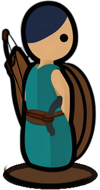
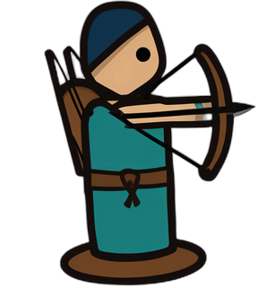
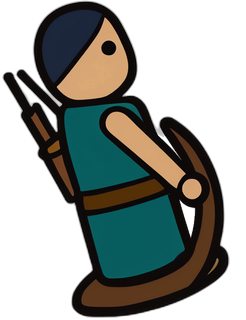
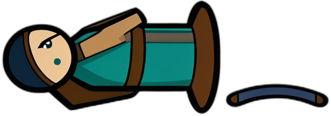
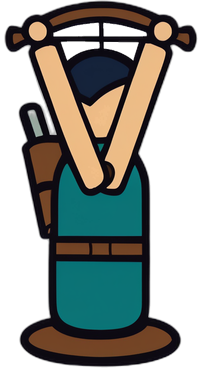
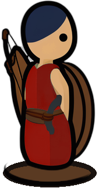
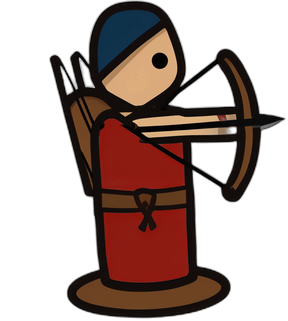

The running slice (engine screenshots, scripted input):

| Board at start | Your arrow hits |
|---|---|
| 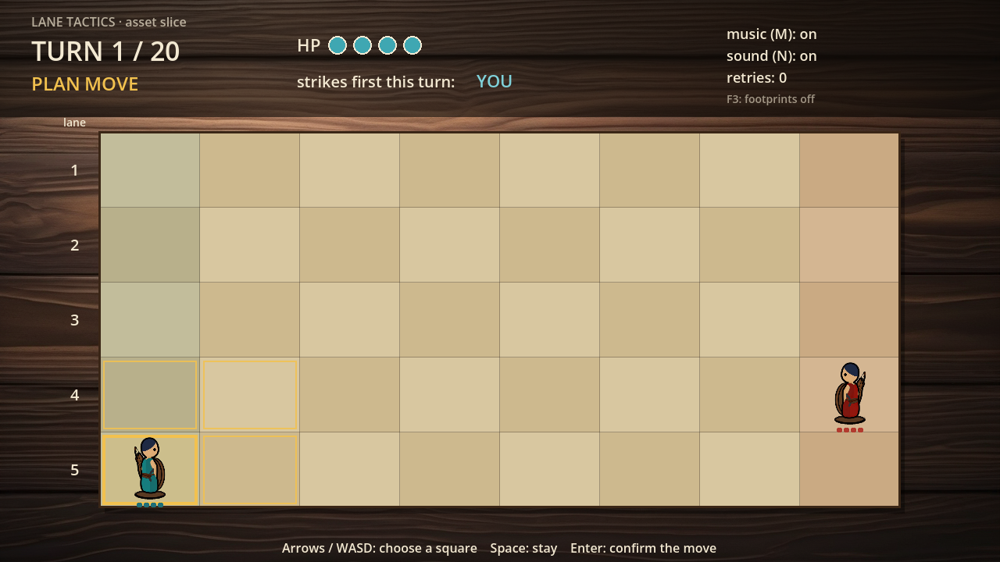 |  |
| **Defeat card** | **Results** |
| 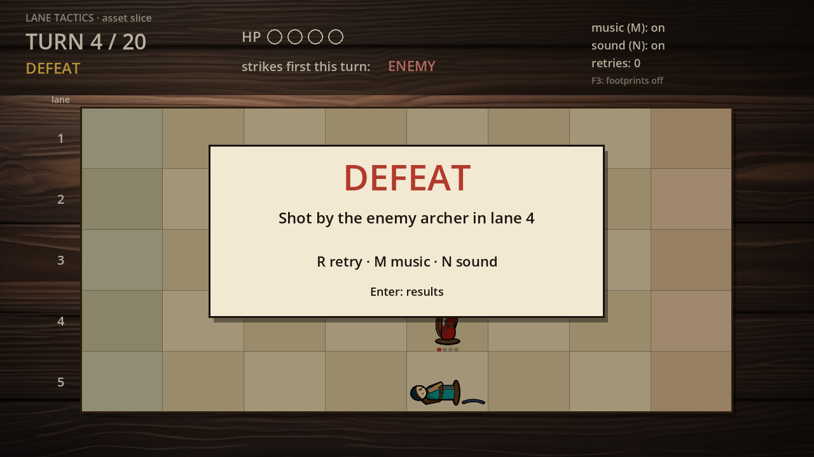 | 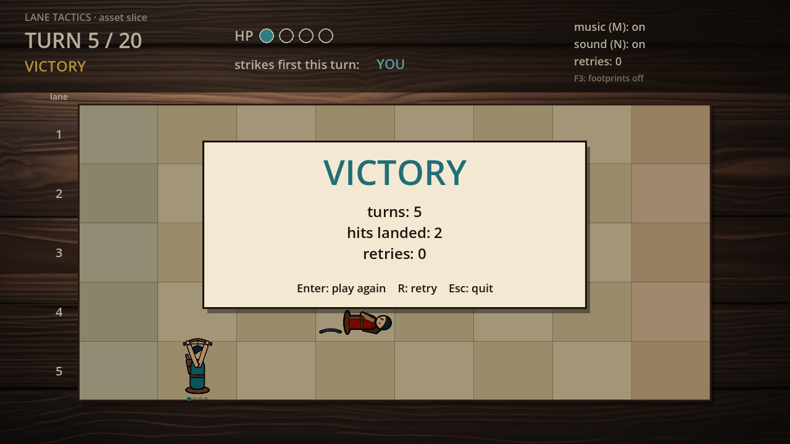 |

**Palette** ([CHARACTER-SHEET.md](CHARACTER-SHEET.md)):

| Role | Hex | Role | Hex |
|---|---|---|---|
| Ink outline | `#1B1410` | Player team paint | `#1F6F78` |
| Birch wood | `#E2B887` | Enemy team paint | `#B23A2E` |
| Hood paint | `#24323F` | Linen squares | `#D8C7A0` / `#CDB98E` |
| Walnut | `#5A3A22` | Table | `#6B4A2E` |

**Readability rules carried into every new asset:**

- One thick, even dark outline around every shape.
- Team paint covers the largest area of the piece.
- Teams face opposite ways (player right, enemy left), so team survives without colour.
- The base disc anchors every pose to the same spot.

**New styling (colours from the sketches):**

| Element | Look |
|---|---|
| Goblins | Carved and painted like the player's pieces: the same base disc, body and outline. Goblin skin `#8E9A5B`, walnut leather cap, yellow eye. Wolf `#6E6A66` |
| Giant | Darker stained wood `#B79B74`, horns `#EFE6D2`, a walnut tower shield, a goblin archer on its back shoulder; drawn taller than one square |
| Mountain | A carved wooden hill (`#8C6F4E`) standing on the linen square; the piece stands on top |
| Night | Dark blue mist (`#0E1424`) over unrevealed squares; revealed squares stay lit; mountains show through the mist; danger zones in red; patrol routes as arrows |
| Mend | A gold glow around the unit until the heal lands |

**Other visual references:** the 9 storyboard panels ([STORYBOARD.md](STORYBOARD.md)), the archer's turnaround, poses, silhouette test and collision overlay ([CHARACTER-SHEET.md](CHARACTER-SHEET.md)), and the 3D archer, board square and goal flag in `godot/assets/models/`.

## 9. Music and sound effects

**Direction:** calm concentration while planning, and short physical punctuation when plans collide. The music is small and acoustic (plucked strings, soft wood percussion, a low drone), never heroic or busy. The effects are dry, close and wooden, like pieces on a table rather than a battlefield.

| Moment | Music | Effects | Status |
|---|---|---|---|
| Title and planning | MUS-LOOP plays | — | Built |
| Move playback | continues | SFX-HOP once per piece that lands in a new square | Built |
| Combat | continues | SFX-HIT when your arrow lands, SFX-HURT when you are hit | Built |
| Pause | ducks by 12 dB | — | Built |
| Defeat | fades out | the last SFX-HURT | Built |
| Win | stops | SFX-WIN alone | Built |
| Melee and blocks | — | melee hit, strike back, shield blocks an arrow | Planned |
| Rider charge | — | a short wooden gallop (a howl for wolf riders) | Planned |
| A piece is defeated | — | a wooden topple | Planned |
| Mend | — | a soft chime or wood tap when the glow appears and when the heal lands | Planned |
| Night | a sparser, darker take on the loop | an alarm horn when an enemy is alarmed | Planned |
| The giant | the same instruments, a faster pulse | heavy footsteps on each giant move | Later |

**Rules for every sound (Built):** each sound is triggered by an event the rules engine already produced, at most once per event. Sound never changes game state. Every sound also has a visual (pose change, "-3", HP pips, card), so the game can be played muted. M and N mute music and effects separately.

## 10. Technical description

| | |
|---|---|
| Engine | Godot 4.7.2, standard build (not .NET), typed GDScript, 2D, Compatibility renderer |
| Display | 1280 × 720 viewport, `canvas_items` stretch, aspect kept; one square = 128 × 96 px; a piece is about 80 px tall |
| Platform | Windows 11 (the only one tested); keyboard input |
| Repository | Godot project in `godot/`, design docs at the root, sketches and tools in `design/`, evidence in `evidence/` |

**Architecture (Built):**

- `godot/game/rules.gd`, the rules engine. It is plain data: board, units and orders go in, and a list of events comes out. It has no nodes and no physics, and it is deterministic. Main functions: `legal_moves`, `valid_targets`, `attack_order`, `resolve_moves`, `resolve_attacks`, `end_turn`; the enemy AI is `enemy_orders` and `enemy_targets`.
- `godot/game/main.gd`, the state machine (`TITLE → PLAN_MOVE → PLAY_MOVES → PLAN_ATTACK → PLAY_ATTACKS → WON / LOST`). It handles input and plays the event list back with tweens: a 0.25 s hop and 0.12 s between landings.
- `godot/game/piece.gd`: one piece, which shows one static image per state, anchored on its base disc. Rules work per square, not per pixel.
- `godot/game/audio_director.gd`: maps events to sounds on separate Music and SFX buses.

**Testing (Built).** Headless scripts in `godot/tests/` write timestamped reports to `evidence/`:

- `test_rules.gd`: the rules
- `test_audio_events.gd`: one sound per event
- `route_runner.gd`: scripted win and lose routes
- `capture.gd`: screenshots
- `analyze_variants.gd`: an exhaustive search over the player's orders, which led to the one-enemy slice
- `check_assets.gd`: the 3D models

Run: `<Godot console exe> --headless --path godot --script res://tests/<test>.gd`.

**Asset pipeline (Built).**

- Images: SDXL base 1.0, run locally.
- Sound effects: ElevenLabs.
- Music: MusicGen small, run locally.
- Processing: Python tools in `design/tools/` (background removal, recolour, trims, the loop cut). Every generation and edit is logged with hashes in `assets/gen-log.jsonl` and `assets/edit-log.jsonl`.
- 3D: Blender 5.2.2 through the Blender MCP, exported to glTF with headless Blender (`tools/blender/export_glb.py`). One Blender metre is one board square.
- Design sketches: `design/tools/draw_sketches.py` (storyboard, character sheet) and `design/tools/draw_gdd_sketches.py` (this document's figures), rendered with `bash design/tools/render_png.sh design/gdd`.

**What the new features need in code:**

- **Level data:** board, terrain, both armies, pool, reinforcements (including when the giant arrives), patrol routes and the starting enemy states, in one data file per level (the test fixtures are already JSON).
- **Terrain:** a per-square terrain grid in `rules.gd`, read by range, movement, damage and sight.
- **Minimum damage:** one clamp where damage is applied.
- **Night:** the set of revealed squares and the danger zones, both computed by the rules engine (pure functions, so they can be tested headlessly); an alarm state per enemy; patrol steps produced as ordinary enemy orders; the mist drawn as an overlay.
- **Mend:** a pending-heal order that carries over one turn. No AI work, because the AI ignores it.
- **Giant:** a unit that fills both slots of its square, moves before the main move, and pushes; the push needs its own events for playback.
- **AI:** orders for riders and shielders.
- **Screens:** level select and army draft.
- **Order input:** the order-input and preview interface is expected to be the biggest job; combat playback needs fast-forward.

## 11. Known design risks

- **Standoffs:** strike back on every hit can stall a fight. Shielders on mountains and Mend both slow fights down, and the turn-limit rule lets the side that is ahead sit on a hill until turn 20. Minimum damage keeps everything killable, but stalling should be checked in the paper test.
- **Player advantages:** Mend and the tie rule both favour the human. Episode 2 onward should be tuned assuming the player has 2 Mends; a two-player mode would need both rules revisited.
- **Hidden information versus pillar 4:** the mist hides enemies, so danger zones and the "attacker reveals its square" rule have to carry readability. A danger zone also hints at where a hidden enemy stands, and its shape at what type it is. That is acceptable: readable danger matters more than a perfect surprise.
- **Night is a lot of new interface:** mist, danger zones, patrol arrows and alarm states all need clear drawing on a small board.
- **The giant's push is harsh:** a unit with no room behind it dies outright. To keep that fair (pillar 4), planning should mark the square the giant will push and any unit that would be destroyed, the way the friendly-fire warning works.
- **Wearing down the giant:** it cannot be blocked and the only win is elimination, so its HP and push damage decide whether the level is fair. Paper-test them before building it.
- **Art volume:** five new pieces plus the giant. The shared goblin head keeps the enemy side to one look.
- **Tedium:** an order for every unit every turn; the default order is "stay".
- **Balance:** every number is a first guess. Paper-test 3–4 turns of each new idea before coding it.

## 12. Open decisions

All rule questions from 2026-10-19 are settled ([RULES.md](RULES.md) "Assumptions to confirm"). Still left for later:

- The giant's arrival turn, HP and push damage, how its shield works, and whether its goblin can be hit on its own.
- Every number in RULES.md "Numbers to tune", which the paper test and playtesting will replace.
