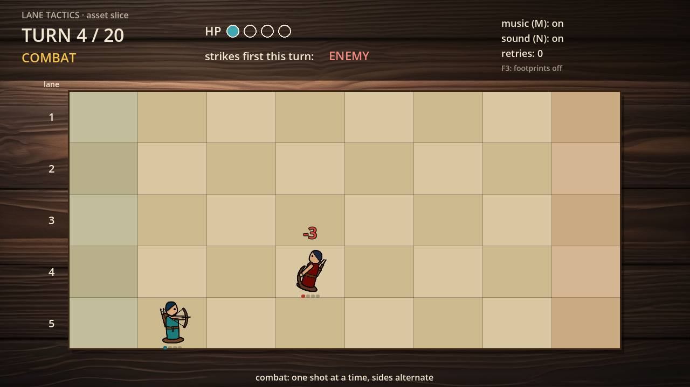

# walker-lane-tactics-jiean-yin

**Lane Tactics · Jiean Yin · current layer: Assignment 6 — Creating Particle Effects with Godot and Claude** (earlier layers below)

*Lane Tactics* (working title): a turn-based, simultaneous-orders tactics game. Carved wooden pieces fight on a five-lane tabletop board, and you win by standing a piece on the enemy's back row. This is the one game I build all semester: each assignment adds a layer to this repository and is submitted as a git tag (`a3` for Assignment 3, `a5` for Assignment 5, `a6` for Assignment 6).

**Started from:** an empty Godot 4.7.2 project (no code from walker-jumpman or my Assignment 1). The test-and-evidence practice and document set come from Assignment 1, which extended Nik Bear Brown's [walker-jumpman](https://github.com/nikbearbrown/walker-jumpman). See [SOURCES.md](SOURCES.md).

| Tool | Version |
|---|---|
| Godot | 4.7.2.stable.official.ed1daf0bf, standard build (not .NET), Compatibility renderer |
| Blender | 5.2.2 LTS (the course chapter used 5.1.2); glTF 2.0 exporter 5.2.40 |
| Blender MCP | [mcp-for-blender](https://github.com/ahujasid/mcp-for-blender) 2.1.9 (server, from PyPI) with its Blender add-on 1.8; uv 0.13.1; telemetry off; every asset library and generator off |
| Claude Code | 2.1.295 (bundled with the Claude desktop app), Claude Opus 5.5 |
| OS | Windows 11 Home 10.0.26200 |

## Game Design Document

[GDD.md](GDD.md) is the whole game in one document: concept, game flow, assets, characters, the story told episode by episode, gameplay (goal, mechanics, abilities, the four episodes, losing and restarting, player skills), graphics, sound and the technical description. It brings together the design docs below and adds the campaign: goblin enemies, mountains, night raids, the Mend ability and the giant boss. The rules for all of this are in [RULES.md](RULES.md), and how each one was decided is in [DESIGN-HISTORY.md](DESIGN-HISTORY.md) section 8. The figures come from `design/tools/draw_gdd_sketches.py` (rendered with `bash design/tools/render_png.sh design/gdd`).

## Assignment 6 — particle effects

**What this layer adds** (contract: [CHANGE-BRIEF.md](CHANGE-BRIEF.md); tuning: [TUNING.md](TUNING.md); results: [TEST-REPORT.md](TEST-REPORT.md), section "Assignment 6"):

- **Effect A, hit burst** (`godot/effects/hit_burst.tscn`, three `CPUParticles2D`):
  - a red flash, wood splinters and a dust puff on the archer each time an arrow hits it (every `"damaged"` event);
  - retrigger rule: **overlap**. Each hit makes a new instance, so the two hits of one turn (1.05 s apart) both show;
  - spawned by `godot/game/hit_burst_driver.gd`.
- **Effect B, arrow trail** (`godot/effects/arrow_trail.tscn`, two `GPUParticles2D`):
  - a streak and turbulent dust wisps behind every arrow in flight, so you can see who shot whom;
  - Compatibility doesn't draw Godot's own particle trails, so the trail comes from world-space emission by an emitter that follows the arrow tip;
  - uses turbulence, which the CPU node lacks;
  - driven by `godot/game/arrow_trail_driver.gd`.
- **Both effects run on game time:** they freeze while the game is paused (P/Esc) and follow the game's speed. Their settings live only in the scene files; the drivers only read game state.
- **Previews and strips:**
  - `godot/previews/hit_burst_preview.tscn` and `arrow_trail_preview.tscn` are fixtures with fixed seeds, for Movie Maker frame strips (`captures/`);
  - `godot/previews/price_effects.tscn` holds each effect at its peak for the GPU price.
- **Tests:** a configuration test and a state test for each effect, the headless price script `godot/tests/cost_effects.gd`, and the generated process shader `godot/shaders/particles_generated.gdshader` (not used by the game).
- **Agent sessions:** the effect scenes, drivers, tests and price script were written by `claude -p` sessions. Their prompts are in `prompts/a6/`, and their redacted transcripts in `evidence/a6/sessions/`. No agent edited `godot/shaders/`.

### Run it

Set `GODOT` to the Godot 4.7.2 console executable, then from the repository root:

```bash
"$GODOT" --headless --path godot --import
"$GODOT" --path godot                                                 # the game (main.tscn)
"$GODOT" --path godot res://previews/hit_burst_preview.tscn           # Effect A fixture (add -- --retrigger for the second hit)
"$GODOT" --path godot res://previews/arrow_trail_preview.tscn         # Effect B fixture
"$GODOT" --path godot res://previews/price_effects.tscn               # price fixture: 0 off, 1 Effect A x2, 2 Effect B x2, V vsync
```

Tests (through the course wrapper, `scripts/run-test.sh <test> <fps|realtime> [timeout]`):

```bash
./scripts/run-test.sh test_rules.gd 60
./scripts/run-test.sh test_audio_events.gd 60
./scripts/run-test.sh check_assets.gd 60
./scripts/run-test.sh test_exposed_tint.gd 30
./scripts/run-test.sh test_exposed_tint.gd 60
./scripts/run-test.sh test_exposed_tint.gd 144
./scripts/run-test.sh test_materials.gd 60
./scripts/run-test.sh test_hit_burst_config.gd 60
./scripts/run-test.sh test_arrow_trail_config.gd 60
./scripts/run-test.sh test_hit_burst_state.gd 60
./scripts/run-test.sh test_arrow_trail_state.gd 60
./scripts/run-test.sh cost_effects.gd 60
```

**Controls:** as in Assignment 2 (below), plus one debug key: **V toggles vsync** (`godot/game/vsync_debug.gd`), for comparing FPS in the GPU price. V was unused; F9 is taken by the editor.

### Known limitations (Assignment 6)

- **The trail is dotted:** `GPUParticles2D` steps at 30 fps, so a fast arrow leaves dots about 20–25 px apart instead of a solid line (predicted failure 8). Jiean judged the path clear as it is.
- **The red flash on the red enemy** has weak contrast over the red tunic; since tuning r2 it reads mainly by its edge over the board.
- **No `"attack_cancelled"` case** can be reached in this 1-vs-1 slice, so "no effect without a hit" is covered only by the per-frame rule in the state tests.
- **Timing:** the trail stops 0 to 2 frames before the impact cue at 60 fps (CHANGE-BRIEF Revision 1).
- **GPU price:** both effects cost less than the Visual Profiler's frame-to-frame swing. The per-case numbers come from averaging the viewport's measured GPU time (TEST-REPORT A6.6).

### Film (Assignment 6)

TO FILL after the film is made: title and link, filename, SHA-256, the game-source revision shown.

## Assignment 5 — shaders, materials and the Godot shading language

**What this layer adds** (contract: [CHANGE-BRIEF.md](CHANGE-BRIEF.md); results: [TEST-REPORT.md](TEST-REPORT.md), section "Assignment 5"):

- **A shader driven by game state.** While you plan a move, your archer turns red when the square you are about to step to lies inside the enemy archer's reach (the state **exposed**). The hand-written shader is `godot/shaders/exposed_tint.gdshader` (`canvas_item`). Every piece's sprite gets its own `ShaderMaterial` (`godot/game/piece.gd`), and `godot/game/exposed_driver.gd` (a node in `main.tscn`) fades the value in and out over 0.20 s of game time. It only reads game state.
- **A textured shader and two materials.** `godot/shaders/linen_square.gdshader` (`spatial`) with the Poly Haven **Hessian 380** cloth (CC0; colour, roughness and OpenGL normal map, credits in `godot/assets/textures/hessian_380/ATTRIBUTION.md`). The materials `godot/materials/linen_light.tres` and `linen_dark.tres` sit on two new 1 m tiles in the A3 diorama (`godot/diorama/asset_diorama.tscn`). Audited in [godot/MATERIALS.md](godot/MATERIALS.md).
- **The hint experiment.** `godot/hint/hint_experiment.tscn` shows a 3 × 1 grey image (written by `godot/tools/write_hint_greys.gd`) on two unshaded quads, with and without `source_color`.
- **Reading the language.** `godot/shaders/standard_generated.gdshader` (a StandardMaterial3D converted in the editor; not used by the game) and [LANGUAGE-NOTES.md](LANGUAGE-NOTES.md).
- **Agent sessions.** `CLAUDE.md` (agent draft plus review), the driver and its test, and the material audit were written by `claude -p` sessions. Their prompts are in `prompts/a5/`, and their redacted transcripts in `evidence/a5/sessions/`. The three shaders are hand-written by Jiean; no agent edited `godot/shaders/`.

### Run it

Set `GODOT` to the Godot 4.7.2 console executable, then from the repository root:

```bash
"$GODOT" --headless --path godot --import
"$GODOT" --path godot                                        # the game (main.tscn)
"$GODOT" --path godot res://diorama/asset_diorama.tscn       # the A3 diorama with the two linen tiles
"$GODOT" --path godot res://hint/hint_experiment.tscn        # the hint experiment
"$GODOT" --path godot res://debug/capture_exposed.tscn       # debug: Enter, then C captures the tint at 0, 0.5, 1, 2
```

Tests (pinned frame rates, through the course wrapper):

```bash
./scripts/run-test.sh test_rules.gd 60
./scripts/run-test.sh test_audio_events.gd 60
./scripts/run-test.sh check_assets.gd 60
./scripts/run-test.sh test_exposed_tint.gd 30
./scripts/run-test.sh test_exposed_tint.gd 60
./scripts/run-test.sh test_exposed_tint.gd 144
./scripts/run-test.sh test_materials.gd 60
```

**Controls** are unchanged from Assignment 2 (below). No key was added to the game. C (capture) exists only in the debug capture scene.

### Known limitations (Assignment 5)

- **Renderer:** the project uses Compatibility (kept for a later web export). On this renderer the hint experiment shows the file's values on both quads, so `source_color` makes no visible difference in this unshaded scene (TEST-REPORT A5.6).
- **Curl check:** the normal-map check separates the right convention from the wrong one (0.68 against 1.32), but with a smaller gap than the course's "about 0 / about 2". The sources are 16-bit and decode as 8-bit.
- **Fade at 30 fps:** at 30 fps a full fade takes 7 frames (0.233 s) instead of 6. Floating-point rounding leaves the value just short of 1.0 after six steps. This is within R2's one-frame tolerance.
- **Unused texture:** the DirectX normal map is kept only to calibrate the curl check. It is imported but never bound.
- **Enemy AI (found in the A5 playtest, to fix later):** the enemy decides at the start of a turn and stays put while it sees your archer in reach. If you step out of reach in the same turn, it neither moves nor shoots, which reads as a pause and lets the player step back for free (TEST-REPORT A5.5).
- **Long path names:** the repository has film-QC file names under `youtube/` long enough to break a clone into a deeply nested Windows folder. Clone into a short path.

### Film (Assignment 5)

**[Lane Tactics: A Danger Tint and a Linen Board](https://youtu.be/laSppfs6n9A)** (YouTube, unlisted), the Brutalist godot-gamedev explainer (walker modifier), made after the source submission.

- File: `claude-liam-walker-lane-tactics-jiean-yin-a5-gamedev.mp4`, 3840 × 2160, 30 fps, 7:26
- SHA-256: `f366ee660bac6ce6b2064d2b083bdb7e607876234761fd0047c5998b50453ebd`
- Game source shown: tag `a5` (`ef5d38b`)
- Film records: [youtube/claude-liam-walker-lane-tactics-jiean-yin-a5-gamedev/](youtube/claude-liam-walker-lane-tactics-jiean-yin-a5-gamedev/)

## Assignment 3 — three 3D assets in a Godot diorama

Lane Tactics is 2D, so this assignment adds a small **3D tabletop diorama** (`godot/diorama/asset_diorama.tscn`: a floor, one light, a camera) with three low-poly assets that I directed Claude to build in my running Blender through the MCP. Later assignments reuse this scene; it is not connected to the 2D game yet.

| Asset | What it is in the game | Size W × D × H (m) | Triangles / budget | Files |
|---|---|---|---|---|
| `archer_piece` | the carved wooden archer unit, in player teal | 0.40 × 0.40 × 0.80 | 254 / 400 | [blend](blender/archer_piece.blend) · [build code](tools/blender/build_archer_piece.py) · [glb](godot/assets/models/archer_piece.glb) |
| `board_square` | one linen square of the 5-lane board | 1.00 × 1.00 × 0.05 | 60 / 100 | [blend](blender/board_square.blend) · [build code](tools/blender/build_board_square.py) · [glb](godot/assets/models/board_square.glb) |
| `goal_flag` | marks the enemy back row you must reach | 0.45 × 0.30 × 1.20 | 84 / 150 | [blend](blender/goal_flag.blend) · [build code](tools/blender/build_goal_flag.py) · [glb](godot/assets/models/goal_flag.glb) |

Scale: **1 board square = 1 m**, and 1 Blender unit = 1 Godot unit = 1 m, so nothing is converted. Every origin is the centre of the asset's underside; every transform is applied (scale 1, 1, 1).

**What this layer added**

- [CHANGE-BRIEF.md](CHANGE-BRIEF.md) Assignment 3 section: sizes, origins, colours, budgets and six predicted failures, committed before any build (`78b213f`), plus revision A3-R1 (darker board border).
- All three assets built through the MCP route (every `execute_blender_code` body is in `tools/blender/build_<asset>.py`); one hand edit of mine in Blender's window (the archer's bow moved 0.08 m so it no longer hides the eye).
- Export to `.glb` with headless Blender from the committed `.blend` files: [tools/blender/export_glb.py](tools/blender/export_glb.py) (+Y Up; refuses an object whose transforms are not applied).
- The diorama scene and a headless check, [godot/tests/check_assets.gd](godot/tests/check_assets.gd), which prints each asset's bounding box, node scale, up axis, lowest point, triangle count and material colours, and checks that each sits on the diorama floor inside the camera's view.
- Records: [BLENDER-NOTES.md](BLENDER-NOTES.md) (the interface in my own words), [TEST-REPORT.md](TEST-REPORT.md) (Assignment 3 section), [FRICTIONAL.md](FRICTIONAL.md) (Assignment 3 section), [SOURCES.md](SOURCES.md).

**Run the check and open the scene** (Windows, Git Bash; on macOS use your Godot path and Homebrew's `timeout`)

```bash
timeout 300 <Godot console exe> --headless --path godot --import
timeout 120 <Godot console exe> --headless --path godot --script res://tests/check_assets.gd --fixed-fps 60
<Godot exe> --path godot res://diorama/asset_diorama.tscn
```

The check exits 0 when every assertion passes and writes `evidence/check_assets-<timestamp>.json` (last run: **38/38**, [evidence/check_assets-1792106192.json](evidence/check_assets-1792106192.json)). In the editor: **Import** `godot/project.godot`, open `res://diorama/asset_diorama.tscn`, press **F6** to see it through the camera. The 2D slice is still the project's main scene (F5).

Re-export (only needed after changing a `.blend`): `<Blender exe> -b --factory-startup --python-exit-code 1 --python tools/blender/export_glb.py -- blender godot/assets/models`

**What the check does not show:** that anything renders or looks right (headless Godot uses a dummy renderer), how the colours read under the lamp, or whether the shapes read as an archer, a square and a flag. That is the human look check in TEST-REPORT A3.5.

**Known limitations (Assignment 3)**

- The goal flag is a 2 cm box: seen exactly from the side (±X) it is edge-on and nearly disappears. The archer's bow is a straight box and reads more like a staff.
- Claude counted the triangles from the mesh; my Blender Scene Statistics cross-check is in TEST-REPORT A3.3.
- The diorama `.tscn` was written by Claude as text and is not connected to the 2D game.
- One computer (Windows only) and one tester.

### Film (Assignment 3)

**"Lane Tactics in 3D: A Piece, a Square, a Goal"**, the Brutalist `godot-gamedev walker` explainer, 4:41, 3840 × 2160, 30 fps, narrated by Liam (local Kokoro TTS).

| | |
|---|---|
| Link | [https://youtu.be/Cb2F8_0mYhk](https://youtu.be/Cb2F8_0mYhk) (YouTube, channel @JieanYin; video title "3D Game Assets with Claude, the Blender MCP, and Blender") |
| File | `claude-liam-walker-lane-tactics-jiean-yin-a3-gamedev.mp4` (kept out of GitHub; MP4) |
| SHA-256 | `83d2489e2ee1f6e6c2d5ffc1df5387f086fba0c51a983904e08b93a2d4ad4240` |
| Game source shown | commit `e415255` (`godot/` identical to the submitted tag `a3`) |

It uses my own screen recordings (the archer after Claude's build, my hand edit, and the Claude window when I approved the flag build), my own Godot screenshot, and a new Movie Maker capture of the real diorama scene with a scripted camera. Claude's archer build and any Blender view of the flag build are not in my recordings; the film says so and does not reconstruct them. Beat sheet, script, prompts, capture records and QC: [youtube/claude-liam-walker-lane-tactics-jiean-yin-a3-gamedev/](youtube/claude-liam-walker-lane-tactics-jiean-yin-a3-gamedev/).

## Assignment 2 — the 2D asset slice

The **asset slice** is a small playable scene that proves the generated art, sound effects and music work together.



### Run it

Requires the standard **Godot 4.7.2** build (not .NET).

```bash
git clone https://github.com/Jiean-Yin/walker-lane-tactics-jiean-yin.git
cd walker-lane-tactics-jiean-yin
```

- **Windows:** clone into a folder whose path is shorter than about 120 characters (for example inside `Downloads`). The longest file path in the repository is 134 characters, and Windows rejects full paths over 260 unless `git config --global core.longpaths true` is set.
- **Editor:** open Godot, **Import**, choose `godot/project.godot`, press **Run** (F5).
- **Command line:** `<Godot exe> --path godot`
- **Tests** (headless, each writes a timestamped report to `evidence/`):

  ```bash
  <Godot console exe> --headless --path godot --import
  <Godot console exe> --headless --path godot --script res://tests/test_rules.gd
  <Godot console exe> --headless --path godot --script res://tests/test_audio_events.gd
  ```

### Controls

| Key | Action |
|---|---|
| Enter | start; confirm the order; play again |
| Arrows / WASD | move phase: choose a neighbouring square · attack phase: cycle the valid targets |
| Space | stay (move) or hold fire (attack) |
| R | retry from turn 1 |
| P / Esc | pause and unpause (music gets quieter) |
| **M** | mute and unmute **music** |
| **N** | mute and unmute **sound effects** |
| F3 | show the footprint slots (debug, display only) |

Your teal archer starts in your back row (left). One red enemy archer marches toward it. Each turn you step, then shoot any square within two steps that holds an enemy. Who strikes first alternates every turn, as the HUD shows. Win by defeating the enemy or by standing on the red back row.

### What the slice demonstrates

| | What | Made with |
|---|---|---|
| Character | the archer swaps one static image per state: **idle, draw, hurt, defeat, win**. It faces right, and the enemy is the same art recoloured and flipped. Art is anchored on the base disc inside a per-square footprint | Stable Diffusion XL base 1.0, run locally (seeds in [assets/gen-log.jsonl](assets/gen-log.jsonl)) |
| Environment | warm-lit walnut tabletop behind the code-drawn linen board | SDXL base 1.0 |
| Sound effects | **SFX-HOP** (a piece lands), **SFX-HIT** (your arrow lands), **SFX-HURT** (you are hit), **SFX-WIN** (you win), each fired once per event from the rules engine's event list | ElevenLabs Sound Effects (free plan) |
| Music | a 24-second, 8-bar loop that plays on the title and in play, ducks on pause, fades out on defeat, stops on win, and restarts on retry | MusicGen small, run locally |

The design came first, committed before any generation: [CONCEPT.md](CONCEPT.md) · [STORYBOARD.md](STORYBOARD.md) · [CHARACTER-SHEET.md](CHARACTER-SHEET.md) · [CHANGE-BRIEF.md](CHANGE-BRIEF.md) · [RULES.md](RULES.md). The rest of the record: [SOURCES.md](SOURCES.md) (models, licences, the asset log with every rejected output) · [TEST-REPORT.md](TEST-REPORT.md) · [FRICTIONAL.md](FRICTIONAL.md). Rejected outputs are in [assets/rejected/](assets/rejected/).

### Known limitations

- **Muted play:** the red target marker is hard to see on a square that holds a piece, and a new player cannot tell why the enemy moves or stops (author's playtest). Planned next: a clearer target colour and a simpler enemy that keeps moving toward the end and avoids direct contact.
- The slice uses **one enemy**; the storyboard drew two. With two, the search showed it could only be won on the tie rule (CHANGE-BRIEF R1).
- **Pose mismatches** against the sheet: hurt has no squint; defeat has a dot eye and a navy bow; the arms cover the face in the win pose. The idle base disc is redrawn by hand.
- The ElevenLabs sounds have no seed, and the exact game description added to their prompts was not recorded.
- One human tester (the author); Windows only.

### Film

**"Lane Tactics: From Sketch to Seed to Sound"**, the Brutalist `godot-gamedev walker` explainer, 6:08, 3840 × 2160, 30 fps, narrated by Liam (local Kokoro TTS).

| | |
|---|---|
| Link | [https://youtu.be/aWLQ2fvkly4](https://youtu.be/aWLQ2fvkly4) (YouTube, channel @JieanYin; video title "Lane tactics game development, sound & art test") |
| File | `claude-liam-walker-lane-tactics-jiean-yin-gamedev.mp4` (kept out of GitHub; MP4) |
| SHA-256 | `543020595fe6e95c9878e14e059c9936b9b1d49097edc8b491d6254b18236aba` |
| Game source shown | tag `film-source-v1` = `fcf33ef` (`godot/` identical to the tested `12f7283`) |

It includes a labelled segment (3:28–3:45) where the slice's own music and sound effects play with no narration over them. The film's beat sheet, script, prompts, capture records and QC are in [youtube/claude-liam-walker-lane-tactics-jiean-yin-gamedev/](youtube/claude-liam-walker-lane-tactics-jiean-yin-gamedev/). Build-machine paths in those records are written as `<repo>`, `<capture-copy>`, `<brutalist>` and `<Godot>`.
