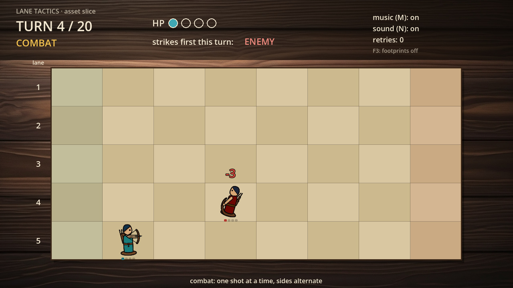

# walker-lane-tactics-jiean-yin

**Lane Tactics · Jiean Yin · current layer: Assignment 3 — Your First 3D Game Assets with Claude, the Blender MCP, and Blender**

*Lane Tactics* (working title): a turn-based, simultaneous-orders tactics game. Carved wooden pieces fight on a five-lane tabletop board, and you win by standing a piece on the enemy's back row. This is the one game I build all semester: each assignment adds a layer to this repository and is submitted as a git tag (`a3` for Assignment 3).

**Started from:** an empty Godot 4.7.2 project (no code from walker-jumpman or my Assignment 1). The test-and-evidence practice and document set come from Assignment 1, which extended Nik Bear Brown's [walker-jumpman](https://github.com/nikbearbrown/walker-jumpman). See [SOURCES.md](SOURCES.md).

| Tool | Version |
|---|---|
| Godot | 4.7.2.stable.official.ed1daf0bf, standard build (not .NET), Compatibility renderer |
| Blender | 5.2.2 LTS (the course chapter used 5.1.2); glTF 2.0 exporter 5.2.40 |
| Blender MCP | [mcp-for-blender](https://github.com/ahujasid/mcp-for-blender) 2.1.9 (server, from PyPI) with its Blender add-on 1.8; uv 0.13.1; telemetry off; every asset library and generator off |
| Claude Code | 2.1.295 (bundled with the Claude desktop app), Claude Opus 5.5 |
| OS | Windows 11 Home 10.0.26200 |

## Assignment 3 — three 3D assets in a Godot diorama

Lane Tactics is 2D, so this assignment adds a small **3D tabletop diorama** (`godot/diorama/asset_diorama.tscn`: a floor, one light, a camera) with three low-poly assets that I directed Claude to build in my running Blender through the MCP. Later assignments reuse this scene; it is not connected to the 2D game yet.

| Asset | What it is in the game | Size W × D × H (m) | Triangles / budget | Files |
|---|---|---|---|---|
| `archer_piece` | the carved wooden archer unit, in player teal | 0.40 × 0.40 × 0.80 | 254 / 400 | [blend](blender/archer_piece.blend) · [build code](tools/blender/build_archer_piece.py) · [glb](godot/assets/models/archer_piece.glb) |
| `board_square` | one linen square of the 5-lane board | 1.00 × 1.00 × 0.05 | 60 / 100 | [blend](blender/board_square.blend) · [build code](tools/blender/build_board_square.py) · [glb](godot/assets/models/board_square.glb) |
| `goal_flag` | marks the enemy back row you must reach | 0.45 × 0.30 × 1.20 | 84 / 150 | [blend](blender/goal_flag.blend) · [build code](tools/blender/build_goal_flag.py) · [glb](godot/assets/models/goal_flag.glb) |

Scale: **1 board square = 1 m**, and 1 Blender unit = 1 Godot unit = 1 m, so nothing is converted. Every origin is the centre of the asset's underside; every transform is applied (scale 1, 1, 1).

**What this layer added**

- [CHANGE-BRIEF.md](CHANGE-BRIEF.md) Assignment 3 section: sizes, origins, colours, budgets and six predicted failures, committed before any build (`78b213f`), plus revision A3-R1 (darker board border).
- All three assets built through the MCP route (every `execute_blender_code` body is in `tools/blender/build_<asset>.py`); one hand edit of mine in Blender's window (the archer's bow moved 0.08 m so it no longer hides the eye).
- Export to `.glb` with headless Blender from the committed `.blend` files: [tools/blender/export_glb.py](tools/blender/export_glb.py) (+Y Up; refuses an object whose transforms are not applied).
- The diorama scene and a headless check, [godot/tests/check_assets.gd](godot/tests/check_assets.gd), which prints each asset's bounding box, node scale, up axis, lowest point, triangle count and material colours, and checks that each sits on the diorama floor inside the camera's view.
- Records: [BLENDER-NOTES.md](BLENDER-NOTES.md) (the interface in my own words), [TEST-REPORT.md](TEST-REPORT.md) (Assignment 3 section), [FRICTIONAL.md](FRICTIONAL.md) (Assignment 3 section), [SOURCES.md](SOURCES.md).

**Run the check and open the scene** (Windows, Git Bash; on macOS use your Godot path and Homebrew's `timeout`)

```bash
timeout 300 /c/Godot/Godot_v4.7.2-stable_win64_console.exe --headless --path godot --import
timeout 120 /c/Godot/Godot_v4.7.2-stable_win64_console.exe --headless --path godot --script res://tests/check_assets.gd --fixed-fps 60
/c/Godot/Godot_v4.7.2-stable_win64.exe --path godot res://diorama/asset_diorama.tscn
```

The check exits 0 when every assertion passes and writes `evidence/check_assets-<timestamp>.json` (last run: **38/38**, [evidence/check_assets-1792106192.json](evidence/check_assets-1792106192.json)). In the editor: **Import** `godot/project.godot`, open `res://diorama/asset_diorama.tscn`, press **F6** to see it through the camera. The 2D slice is still the project's main scene (F5).

Re-export (only needed after changing a `.blend`): `"/c/Program Files/Blender Foundation/Blender 5.2/blender.exe" -b --factory-startup --python-exit-code 1 --python tools/blender/export_glb.py -- blender godot/assets/models`

**What the check does not show:** that anything renders or looks right (headless Godot uses a dummy renderer), how the colours read under the lamp, or whether the shapes read as an archer, a square and a flag. That is the human look check in TEST-REPORT A3.5.

**Known limitations (Assignment 3)**

- The goal flag is a 2 cm box: seen exactly from the side (±X) it is edge-on and nearly disappears. The archer's bow is a straight box and reads more like a staff.
- Claude counted the triangles from the mesh; my Blender Scene Statistics cross-check is in TEST-REPORT A3.3.
- The diorama `.tscn` was written by Claude as text and is not connected to the 2D game.
- One computer (Windows only) and one tester.

**Film (Assignment 3):** to be added after rendering (link, file name and SHA-256).

## Assignment 2 — the 2D asset slice

The **asset slice** is a small playable scene that proves the generated art, sound effects and music work together.



### Run it

Requires the standard **Godot 4.7.2** build (not .NET).

```bash
git clone https://github.com/Jiean-Yin/walker-lane-tactics-jiean-yin.git
cd walker-lane-tactics-jiean-yin
```

- **Windows:** clone into a folder whose path is shorter than about 120 characters (for example inside `Downloads`). The longest file path in the repository is 134 characters, and Windows rejects full paths over 260 unless `git config --global core.longpaths true` is set.
- **Editor:** open Godot, **Import**, choose `godot/project.godot`, press **Run** (F5).
- **Command line:** `<Godot exe> --path godot`
- **Tests** (headless, each writes a timestamped report to `evidence/`):

  ```bash
  <Godot console exe> --headless --path godot --import
  <Godot console exe> --headless --path godot --script res://tests/test_rules.gd
  <Godot console exe> --headless --path godot --script res://tests/test_audio_events.gd
  ```

### Controls

| Key | Action |
|---|---|
| Enter | start; confirm the order; play again |
| Arrows / WASD | move phase: choose a neighbouring square · attack phase: cycle the valid targets |
| Space | stay (move) or hold fire (attack) |
| R | retry from turn 1 |
| P / Esc | pause and unpause (music gets quieter) |
| **M** | mute and unmute **music** |
| **N** | mute and unmute **sound effects** |
| F3 | show the footprint slots (debug, display only) |

Your teal archer starts in your back row (left). One red enemy archer marches toward it. Each turn you step, then shoot any square within two steps that holds an enemy. Who strikes first alternates every turn, as the HUD shows. Win by defeating the enemy or by standing on the red back row.

### What the slice demonstrates

| | What | Made with |
|---|---|---|
| Character | the archer swaps one static image per state: **idle, draw, hurt, defeat, win**. It faces right, and the enemy is the same art recoloured and flipped. Art is anchored on the base disc inside a per-square footprint | Stable Diffusion XL base 1.0, run locally (seeds in [assets/gen-log.jsonl](assets/gen-log.jsonl)) |
| Environment | warm-lit walnut tabletop behind the code-drawn linen board | SDXL base 1.0 |
| Sound effects | **SFX-HOP** (a piece lands), **SFX-HIT** (your arrow lands), **SFX-HURT** (you are hit), **SFX-WIN** (you win), each fired once per event from the rules engine's event list | ElevenLabs Sound Effects (free plan) |
| Music | a 24-second, 8-bar loop that plays on the title and in play, ducks on pause, fades out on defeat, stops on win, and restarts on retry | MusicGen small, run locally |

The design came first, committed before any generation: [CONCEPT.md](CONCEPT.md) · [STORYBOARD.md](STORYBOARD.md) · [CHARACTER-SHEET.md](CHARACTER-SHEET.md) · [CHANGE-BRIEF.md](CHANGE-BRIEF.md) · [RULES.md](RULES.md). The rest of the record: [SOURCES.md](SOURCES.md) (models, licences, the asset log with every rejected output) · [TEST-REPORT.md](TEST-REPORT.md) · [FRICTIONAL.md](FRICTIONAL.md). Rejected outputs are in [assets/rejected/](assets/rejected/).

### Known limitations

- **Muted play:** the red target marker is hard to see on a square that holds a piece, and a new player cannot tell why the enemy moves or stops (author's playtest). Planned next: a clearer target colour and a simpler enemy that keeps moving toward the end and avoids direct contact.
- The slice uses **one enemy**; the storyboard drew two. With two, the search showed it could only be won on the tie rule (CHANGE-BRIEF R1).
- **Pose mismatches** against the sheet: hurt has no squint; defeat has a dot eye and a navy bow; the arms cover the face in the win pose. The idle base disc is redrawn by hand.
- The ElevenLabs sounds have no seed, and the exact game description added to their prompts was not recorded.
- One human tester (the author); Windows only.

### Film

**"Lane Tactics: From Sketch to Seed to Sound"**, the Brutalist `godot-gamedev walker` explainer, 6:08, 3840 × 2160, 30 fps, narrated by Liam (local Kokoro TTS).

| | |
|---|---|
| Link | [https://youtu.be/aWLQ2fvkly4](https://youtu.be/aWLQ2fvkly4) (YouTube, channel @JieanYin; video title "Lane tactics game development, sound & art test") |
| File | `claude-liam-walker-lane-tactics-jiean-yin-gamedev.mp4` (kept out of GitHub; MP4) |
| SHA-256 | `543020595fe6e95c9878e14e059c9936b9b1d49097edc8b491d6254b18236aba` |
| Game source shown | tag `film-source-v1` = `fcf33ef` (`godot/` identical to the tested `12f7283`) |

It includes a labelled segment (3:28–3:45) where the slice's own music and sound effects play with no narration over them. The film's beat sheet, script, prompts, capture records and QC are in [youtube/claude-liam-walker-lane-tactics-jiean-yin-gamedev/](youtube/claude-liam-walker-lane-tactics-jiean-yin-gamedev/). Build-machine paths in those records are written as `<repo>`, `<capture-copy>`, `<brutalist>` and `<Godot>`.
