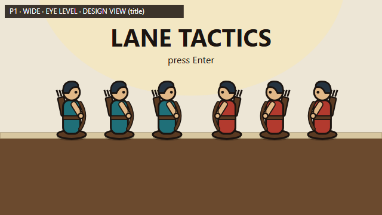
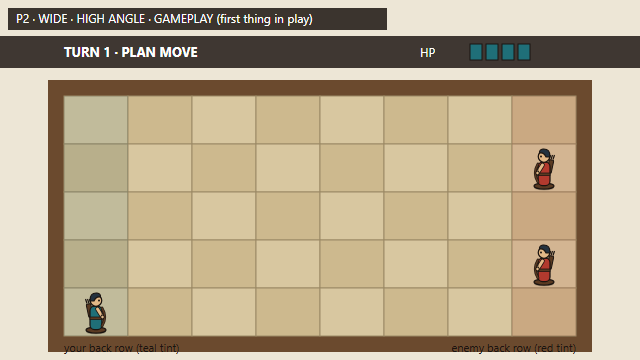
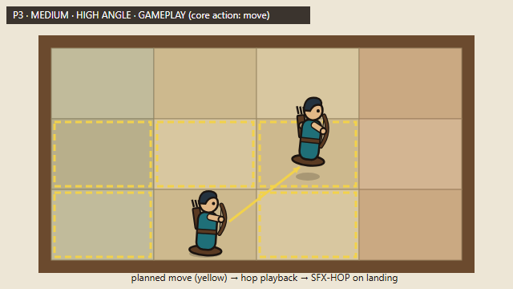
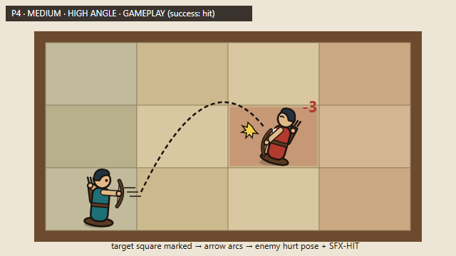
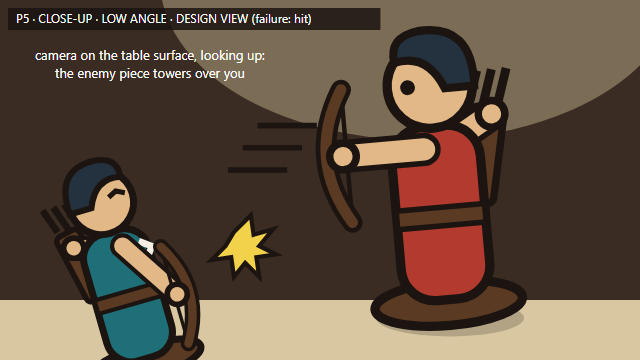
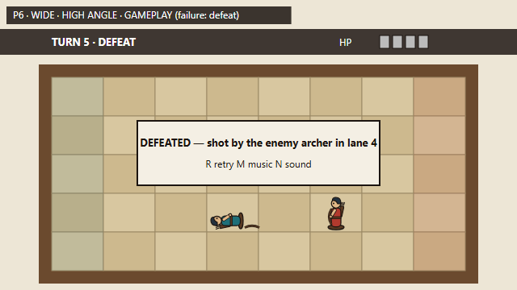
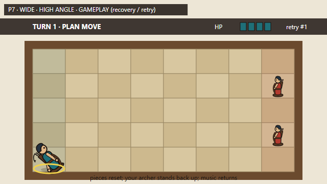
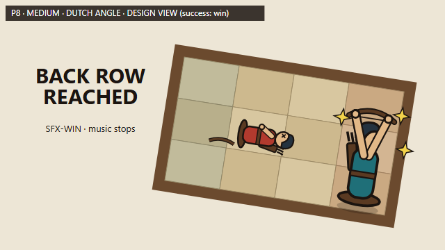
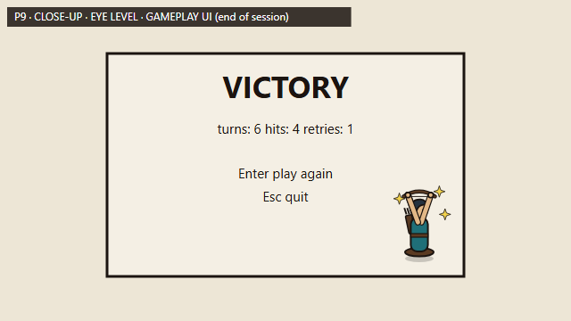

# STORYBOARD — one session of the Lane Tactics asset slice

*Version 1, 2026-10-09, before any asset was generated.* Frame shape: **16:9** throughout (640 × 360 sketches, 1280 × 720 game viewport). The sketches are design sketches drawn by Claude Code as SVG under Jiean Yin's direction (source: [design/tools/draw_sketches.py](design/tools/draw_sketches.py)). They are not generated art. Asset IDs match [CHANGE-BRIEF.md](CHANGE-BRIEF.md) and the asset log in [SOURCES.md](SOURCES.md).

The game's camera is fixed: a **high angle** looking down over the board, with pieces drawn upright in profile. Panels marked *gameplay view* show only what that camera shows. Panels marked *design view* show how the world and pieces should feel from angles the game never uses.

| Panel | View | Angle | Kind |
|---|---|---|---|
| 1 Title | wide | eye level | design view (title screen) |
| 2 Board at start | wide | high | gameplay |
| 3 Move | medium | high | gameplay |
| 4 Hit | medium | high | gameplay |
| 5 Being hit | close-up | low | design view |
| 6 Defeat | wide | high | gameplay |
| 7 Retry | wide | high | gameplay |
| 8 Win | medium | Dutch (tilted) | design view |
| 9 Results | close-up | eye level | gameplay UI |

That makes **3 views** (wide, medium, close-up) and **4 angles** (eye level, high, low, Dutch).

---

## Panel 1 — Title

- **Shot:** wide · eye level · design view (title screen)
- **Player action:** sees the title and presses Enter; the game moves to the board.
- **See:** both armies lined up along the table edge, teal facing right and red facing left; title text; "press Enter".
- **Hear:** MUS-LOOP starts.
- **Assets:** CHAR-IDLE, ENEMY-IDLE, ENV-TABLE, MUS-LOOP
- **Design reason (pillar 1, read the board):** before any rule is explained, the player learns that teal faces right and red faces left.

## Panel 2 — Board at start (first thing in play)

- **Shot:** wide · high angle · gameplay view
- **Player action:** reads the board; the game is in TURN 1 · PLAN MOVE and waits for an order.
- **See:** the 5 × 8 linen board on the table; your archer in your back row (teal tint, left); two enemy archers in their back row (red tint, right); HUD with turn, phase and 4 HP pips.
- **Hear:** MUS-LOOP playing; no effects.
- **Assets:** CHAR-IDLE, ENEMY-IDLE, ENV-TABLE, MUS-LOOP
- **Design reason (pillar 1):** both goals (the two back rows) and both teams are readable in one look.

## Panel 3 — Core action: move

- **Shot:** medium · high angle · gameplay view
- **Player action:** steers the yellow order marker to a neighbouring square and confirms with Enter. Both sides' moves then play out: each piece hops to its new square.
- **See:** archer in the ready pose while selected; legal squares outlined in yellow; planned-move arrow; during playback the piece lifts (hop) and lands.
- **Hear:** SFX-HOP once for each piece that lands in a new square; MUS-LOOP continues.
- **Assets:** CHAR-IDLE (ready/hop use the idle image with a lift in code unless CHAR-HOP is generated), SFX-HOP, ENV-TABLE
- **Design reason (pillar 3, weight):** a move is a physical hop with a clack, not a slide.

## Panel 4 — Success: the arrow hits

- **Shot:** medium · high angle · gameplay view
- **Player action:** in PLAN ATTACK, picks a red-marked target square with an enemy in it (within the 5 × 5 range) and confirms. In combat, the archer shoots and the enemy loses 3 HP.
- **See:** CHAR-DRAW, then the arrow's arc; the target square stays marked until the hit; the enemy switches to its hurt pose; a "-3" number.
- **Hear:** SFX-HIT when the arrow lands; MUS-LOOP continues.
- **Assets:** CHAR-DRAW, ENEMY-HURT, PROP-ARROW, SFX-HIT
- **Design reason (pillar 4, fair consequences):** the target is shown before the hit, so the outcome matches the decision.

## Panel 5 — Failure: being hit

- **Shot:** close-up · low angle · design view
- **Player action:** the enemy archer shoots first this turn; your archer takes 3 damage.
- **See:** your archer in the hurt pose, leaning away from the shot; the enemy piece towering over it from the table surface.
- **Hear:** SFX-HURT; MUS-LOOP continues.
- **Assets:** CHAR-HURT, ENEMY-DRAW, SFX-HURT
- **Design reason (pillar 4):** how being hit should feel: the threat is big and the direction of the hit is obvious. In gameplay (high angle) this is the same hurt pose, plus HP pips dropping and a "-3".

## Panel 6 — Failure: defeat

- **Shot:** wide · high angle · gameplay view
- **Player action:** HP reaches 0; the game ends the attempt and waits for R.
- **See:** your archer toppled (defeat pose) on the square where it fell; the enemy that shot it still standing; a card naming the cause ("shot by the enemy archer in lane 4") and the retry and mute keys.
- **Hear:** the final SFX-HURT, then MUS-LOOP fades out to silence.
- **Assets:** CHAR-DEFEAT, ENEMY-IDLE, ENV-TABLE
- **Design reason (pillar 4):** the cause stays on screen, so the player knows what to try differently.

## Panel 7 — Recovery: retry

- **Shot:** wide · high angle · gameplay view
- **Player action:** presses R; the board resets to turn 1.
- **See:** your archer back on its start square (recover → idle), a retry counter in the HUD, enemies back in their back row.
- **Hear:** MUS-LOOP restarts from the top.
- **Assets:** CHAR-IDLE (CHAR-RECOVER only if generated), ENEMY-IDLE, MUS-LOOP
- **Design reason (pillar 2, plans collide):** retry is instant, so the player can try a different timing.

## Panel 8 — Success: win

- **Shot:** medium · Dutch (tilted) angle · design view
- **Player action:** ends a turn with the archer on the enemy back row (or both enemies defeated).
- **See:** your archer celebrating on the red back-row square; a toppled enemy; "BACK ROW REACHED".
- **Hear:** MUS-LOOP stops; SFX-WIN plays alone.
- **Assets:** CHAR-WIN, ENEMY-DEFEAT, SFX-WIN
- **Design reason (pillar 3):** the tilted frame shows the moment is unbalanced and exciting. In gameplay the camera stays level; the celebrate pose and the sound carry it.

## Panel 9 — End of session: results

- **Shot:** close-up · eye level · gameplay UI
- **Player action:** reads the result; Enter plays again, Esc quits.
- **See:** VICTORY (or DEFEAT), turns, hits and retries; a small celebrating piece.
- **Hear:** silence (music stays stopped; SFX-WIN has finished).
- **Assets:** CHAR-WIN, UI (code-drawn)
- **Design reason (pillar 4):** a short summary the player can read at a glance.

## Revisions

*(none yet)*
