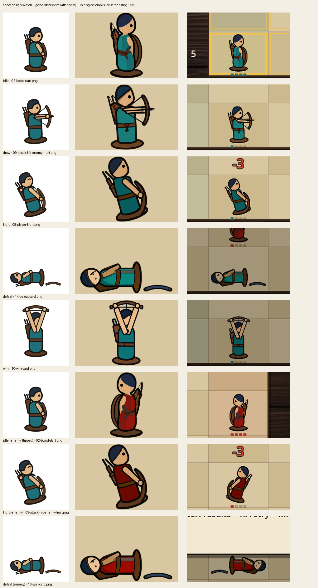

# TEST-REPORT — Lane Tactics asset slice

| | |
|---|---|
| Source revision tested | `12f7283` (all generated assets in place) |
| Engine | Godot 4.7.2.stable.official.ed1daf0bf, standard build, Compatibility renderer |
| OS | Windows 11 Home 10.0.26200 |
| Testers | Jiean Yin (human playtest, sound on and muted); automated suites and scripted captures run by Claude Code |
| Date | 2026-10-12 / 13 |

## 1. Startup and controls (fresh copy)

A fresh `git clone` of GitHub `main` at `12f7283` into an empty folder, then:

```bash
<Godot console exe> --headless --path godot --import
<Godot console exe> --headless --path godot --script res://tests/test_rules.gd
<Godot console exe> --headless --path godot --script res://tests/test_audio_events.gd
<Godot console exe> --headless --path godot --quit-after 300
```

| Check | Result |
|---|---|
| Import | no errors |
| test_rules | **51/51** ([evidence/fresh-clone-test_rules-1791864624.json](evidence/fresh-clone-test_rules-1791864624.json)) |
| test_audio_events | **70/70** ([evidence/fresh-clone-test_audio_events-1791864624.json](evidence/fresh-clone-test_audio_events-1791864624.json)) |
| Main scene, 300 frames headless | runs; at the forced quit Godot prints `ERROR: 2 resources still in use at exit`, an engine shutdown warning with no gameplay effect (not investigated further) |
| Used assets present | 16 files: 10 archer sprites + `env_table.png`, 4 SFX OGG, `mus_loop.ogg` |
| Controls | Jiean played with Enter, arrows/WASD, Space, R, P/Esc, M, N and F3 (section 6): "All fine". Every state change is also driven by the scripted input in test_audio_events and capture.gd |

## 2. Character against the sheet



Left: the character-sheet design sketch. Middle: the generated sprite after the logged edits. Right: the same state cropped from an in-engine screenshot (`evidence/screens-1791864538/`, scripted input).

| State | Matches the sheet | Mismatch |
|---|---|---|
| idle | proportions, one eye, navy hood, teal body, base disc | the base disc is redrawn by hand (the model painted it near-white and the halo cleanup erased it; see R3) |
| draw | bow arm forward, arrow nocked, base | — |
| hurt | leans back away from the attacker | the eye is open; the sheet's hurt pose has a squint |
| defeat | toppled, bow beside it | the eye is a dot, not the sheet's ✕; the bow came out navy, not walnut |
| win | arms and bow overhead | the arms cover the face; this comes from the sketch, not the model |
| **Orientation** | the player faces right; the enemy is the same image flipped to face left; the enemy's hurt pose leans away from the player | — |
| **Collision** (F3, [03-footprint-debug-f3.png](evidence/screens-1791864538/03-footprint-debug-f3.png)) | the art is anchored on the base-disc centre in the 64 × 96 slot | the bow in draw and the toppled body in defeat reach beyond the slot. As the sheet states, rules resolve per square, so this never changes a result |

## 3. Storyboard against the slice

Each pair is in `evidence/compare/storyboard-*.png` (left: design sketch; right: engine screenshot from scripted input).

| Panel | Slice screenshot | Differences and why |
|---|---|---|
| P1 Title (design view, eye level) | [01-title](evidence/compare/storyboard-01-title.png) | The slice shows a text card over the board, not pieces lined up at eye level. The game camera has no eye-level view; the title art stays a design view |
| P2 Board at start | [02-board-start](evidence/compare/storyboard-02-board-start.png) | **One enemy, not two** (CHANGE-BRIEF R1). Lane numbers, the who-strikes-first line and mute status were added to the HUD |
| P3 Move | [05-move-playback-hop](evidence/compare/storyboard-03-move.png) | The hop uses the idle image lifted in code (no CHAR-HOP generated, as the brief allowed). The planned-move marker is in [12-plan-move-marker-lose](evidence/screens-1791864538/12-plan-move-marker-lose.png) |
| P4 Hit | [09-attack-hit-enemy-hurt](evidence/compare/storyboard-04-hit.png) | As designed: marked target square, arrow, enemy hurt pose, "-3" |
| P5 Being hit (design view, low angle) | [08-player-hurt](evidence/compare/storyboard-05-hurt.png) | The slice shows the same moment from the fixed high angle (hurt pose, "-3", HP pips). The low angle is not a game camera |
| P6 Defeat | [14-defeat-card](evidence/compare/storyboard-06-defeat.png) | As designed: toppled piece, cause named on the card. One enemy |
| P7 Retry | [15-retry-board](evidence/compare/storyboard-07-retry.png) | The piece returns in the idle pose (no CHAR-RECOVER generated); the retry counter is in the HUD |
| P8 Win (design view, Dutch angle) | [10-win-card](evidence/compare/storyboard-08-win.png) | The slice is level (no Dutch tilt), as the storyboard said. The win shown is "ENEMY DEFEATED" (elimination); "BACK ROW REACHED" also exists in code but the capture route wins by elimination |
| P9 Results | [11-results-victory](evidence/compare/storyboard-09-results.png) | As designed |

Not covered by the slice: the eye-level title art (P1), the low-angle (P5) and Dutch-angle (P8) design views, and the second enemy in P1, P2, P6 and P7.

## 4. Sound events

| Event | Sound | Automated: triggers = events | Human (Jiean) |
|---|---|---|---|
| a piece lands in a new square | SFX-HOP | win route 5 = 5 moved events, lose route 7 = 7 | Part A: "All fine" |
| the player's arrow damages the enemy | SFX-HIT | 2 = 2 / 1 = 1 | " |
| the player is damaged | SFX-HURT | 1 = 1 / 2 = 2 | " |
| entering WON | SFX-WIN | 1 on the win route, 0 on the lose route | " |

Rapid repeats and held input: the scripted runs send held (echo) Enter and repeated presses during playback. They add no events and no sounds (test_audio_events). The sounds are generated files loaded from `godot/assets/sfx` (new check: "all four generated SFX and the music loop are loaded").

## 5. Music

| Check | Evidence | Result |
|---|---|---|
| Loop seam | `process_audio.py`: 8 bars at 79.8 bpm, 40 ms crossfade, sample jump at the wrap 0.0016 (below the clip's typical step) | pass |
| Seam by ear, 3+ repetitions (about 75 s on the title) | Jiean, Part A | "All fine" |
| Pause ducks, unpause restores; defeat fades out; win stops before SFX-WIN; retry restarts | test_audio_events music checks (flags read from the AudioDirector) | pass |
| M mutes music only, N mutes effects only | test_audio_events (buses) + Jiean | pass / "All fine" |

## 6. Human playtest — Jiean Yin, 2026-10-13

**Checklist played** (given by Claude): Part A with sound on: the title music over 3 loops; a loss and a win played as a new player would; P, R, M, N, F3. Part B, all muted: one more game.

**Jiean's report (verbatim):**

> All fine. For part B, I found it not clear if the attack target is on the character's board. We need to change at least the color later for clear viewing. And the enemy's moving logic seems weird, a new player cannot understand why enemy move or not. I will suggest making some easy logic first like "enemy try keep moving to the end and may avoid direct contact with the opponent". For now, we keep that only for testing art and sound.

**What this means for the predictions:** prediction 5 (the slice is unreadable when muted) **partly happened**. The sounds were not the problem. Without sound, the target marker on an occupied square and the enemy's reason for moving or stopping are not readable. Both are recorded as known limitations (section 10). The art-and-sound purpose of the slice was judged fine.

## 7. Automated checks added by this project

| Suite | Command | What it proves | Result |
|---|---|---|---|
| `tests/test_rules.gd` | see section 1 | setup, legal moves, 24-square range, friendly fire, alternating attack order, killed-before-turn, attack cancelled, every win and loss condition, determinism, V4 default; the win route is not a tie | 51/51 |
| `tests/test_audio_events.gd` | see section 1 | the full scene driven by synthetic key presses on the win and lose routes: sounds == events for each id, echo/rapid input adds nothing, the muted run ends in an identical rules snapshot, music behaviour, all assets loaded | 70/70 |
| `tests/analyze_variants.gd` | `--script res://tests/analyze_variants.gd` | exhaustive search over every player order for rule variants (used for R1) | [evidence/analyze_variants-1791859618.json](evidence/analyze_variants-1791859618.json) |
| `tests/capture.gd` | windowed exe `--script res://tests/capture.gd` | 15 engine screenshots from scripted input | [evidence/screens-1791864538/](evidence/screens-1791864538/) |

No assertion was removed or loosened. One label was corrected: the check named "no sound files present" became "every logged trigger's file flag matches whether its stream is loaded". The label had become false once real files existed; the logic was always the flag check. A stricter check was added beside it.

## 8. Inspect-and-revise cycles

| # | Observation (evidence) | Change | Result |
|---|---|---|---|
| R1 | The exhaustive search found 1 vs 2 archers winnable only through the tie rule (`analyze_variants`) | one marching enemy (CHANGE-BRIEF R1, accepted by Jiean) | winnable without a tie; both naive plans lose |
| R2 | CHAR-REF ref01 came out photo-real 3D on grey; ref02 cartoon humans with legs (`assets/rejected/CHAR-REF-ref01/02`) | prompt rewritten to lead with "2D game sprite on a plain white background"; then image-to-image from the sheet's idle sketch with a strength sweep 0.75 → 0.85 → 0.80 | 0.75 too close to the sketch, 0.85 drifted from the sheet; 0.80 accepted (s202) |
| R3 | The idle s211 cut-out lost its base disc: the model painted it near-white and the halo cleanup removed it (`assets/_raw` check sheet; rule 1 "base disc always visible") | first a fill inside the outline (left a gap, rejected), then a base disc redrawn behind the piece at the sheet's 40 × 12 size, logged in edit-log | base visible in game ([character-vs-sheet](evidence/compare/character-vs-sheet.png), idle row) |
| R4 | Every pose prompt was 78–81 CLIP tokens, so SDXL would cut off "painted wood grain texture", the phrase that made s202 read as wood | shortened only the pose phrases; the piece description stays word-for-word | all prompts ≤ 77 tokens |
| R5 | Muted playtest: target marker and enemy logic unclear (section 6) | **not changed in this slice** (Jiean's decision); planned next | — |

## 9. Predictions (CHANGE-BRIEF) against results

| # | Prediction | What happened |
|---|---|---|
| 1 | Poses drift from the reference | **Happened:** with the same seed, draw and hurt lost the navy hood (s202 turned teal), and two seeds grew long hair. Caught by the sheet check, and those seeds were rejected |
| 2 | Piece disappears against the background | **Did not happen:** all states read at 80 px on linen and table (comparison sheets); the dark outline carries the birch head as the sheet required |
| 3 | A sound fires twice | **Did not happen:** counts equal events, including held and rapid input |
| 4 | Music loop clicks | **Did not happen:** seam metric pass; Jiean heard no problem |
| 5 | Unreadable when muted | **Partly happened:** see section 6 |
| 6 | Background-removal halos | **Happened:** a white halo under the base of CHAR-REF s202 and s203. The cleanup step (near-white → transparent) removed it, but it also erased idle s211's near-white base (R3) |
| 7 | Recolour shifts wood and skin | **Did not happen:** only the teal hue range changed; the navy hood and the wood are unchanged |

## 10. Known limitations and uncertainty

- **Muted readability:** the red target marker is hard to see on a square that holds a piece; the enemy's reason for moving or stopping is not shown (Jiean's playtest). Next step proposed by Jiean: a simpler enemy that keeps moving toward the end and avoids direct contact.
- **Pose mismatches:** hurt has no squint; defeat has a dot eye and a navy bow; the arms cover the face in win.
- **One enemy, not two;** P1/P5/P8 design views are not game cameras.
- **Reproducibility:** the SDXL and MusicGen rows can be reproduced from their seeds. The ElevenLabs sounds cannot (no seed, and the exact added game description was not recorded).
- **One human tester** (the author); no new-player evidence. Tested on Windows only.
- The engine's `2 resources still in use at exit` warning on forced quit was not investigated.

---

# Assignment 3 — three 3D assets (Blender through the MCP → glTF → Godot)

| | |
|---|---|
| Source revision tested | `bacb97b` (assets built in `0609504`, `d4c87d1`, `fbb0a90`; exported from `fbb0a90`) |
| Blender | 5.2.2 LTS (hash d13f752e3b9c, built 2026-09-15); glTF 2.0 add-on 5.2.40 |
| MCP | mcp-for-blender 2.1.9 (PyPI), Blender add-on 1.8, uv 0.13.1, Claude Code 2.1.295; all asset libraries and generators off |
| Godot | 4.7.2.stable.official.ed1daf0bf, standard build, Compatibility renderer |
| OS | Windows 11 Home 10.0.26200 (the course's commands are for macOS; Windows equivalents below) |
| Testers | headless checks run by Claude Code; human look check by Jiean Yin |
| Date | 2026-10-15 |
| Brief | CHANGE-BRIEF.md, Assignment 3 section (`78b213f`, committed before any build) and revision A3-R1 |

## A3.1 Commands (Windows, Git Bash)

```bash
# export, headless Blender, from the committed .blend files (no MCP)
"/c/Program Files/Blender Foundation/Blender 5.2/blender.exe" -b --factory-startup --python-exit-code 1 \
    --python tools/blender/export_glb.py -- <dir with the .blend files> godot/assets/models
# import, then the check (timeout comes with Git Bash; the course's macOS version uses Homebrew coreutils)
timeout 300 /c/Godot/Godot_v4.7.2-stable_win64_console.exe --headless --path godot --import
timeout 120 /c/Godot/Godot_v4.7.2-stable_win64_console.exe --headless --path godot --script res://tests/check_assets.gd --fixed-fps 60
# open the scene (window)
/c/Godot/Godot_v4.7.2-stable_win64.exe --path godot res://diorama/asset_diorama.tscn
```

## A3.2 Results against the course's checks

| Check | Evidence | Result |
|---|---|---|
| **Interface notes** | [BLENDER-NOTES.md](BLENDER-NOTES.md), six parts in my own words, screenshot `evidence/blender/window-session.png` | Done |
| **Size** | table A3.3 | brief = Blender = Godot to 4 decimals for all three |
| **Upright and scale** | `check_assets.gd`: height axis, node scale and rotation of every imported node | all three stand along Godot Y; every node scale (1, 1, 1), rotation 0 |
| **Origin** | Blender mesh z min; Godot AABB min y alone and in the diorama against the Floor mesh's top | lowest point 0.0000 m everywhere; gap to the floor 0.0000 m for all three |
| **Triangle count** | table A3.3; Blender's Scene Statistics (status bar) | Claude's counts within budget; Scene Statistics read by Jiean: 254, 60, 84. All match Claude's data. |
| **Imports and appears** | `--import` exit 0, no error/warn/fail line; diorama loads, all corners in the camera's view | imports clean; on screen: All three visible when I open the scene and press F6. |
| **HUMAN CHECK: look** | Jiean orbits the camera around each asset in Godot, including behind and below | The unit need a more detailed face to be distinguished as an archer, and the flag may be replaced to something seemly more rewarding — see A3.5 |
| **What Claude got wrong** | A3.4 | three things |

Headless reports: [evidence/check_assets-1792106192.json](evidence/check_assets-1792106192.json) (**38/38**) and the earlier, faulty run [evidence/check_assets-1792106172.json](evidence/check_assets-1792106172.json) (32/33, kept on purpose; see A3.4).

## A3.3 Numbers: brief, Blender, Godot

Blender values are the object's `dimensions` (what the sidebar's **Dimensions** field shows), read through the MCP right after each build and again by `export_glb.py`. Triangles in Blender were counted by Claude from the mesh polygons. Godot values are headless measurements of the imported `.glb` (W × H × D = Godot X, Y, Z; Godot Y = Blender Z).

| Asset | Brief W × D × H (m) | Blender dimensions X × Y × Z | Godot AABB X × Y × Z | Lowest point (Blender z / Godot y) | Triangles (Blender / Godot) / budget | Colours in Godot |
|---|---|---|---|---|---|---|
| `archer_piece` | 0.40 × 0.40 × 0.80 | 0.40 × 0.40 × 0.80 | 0.4000 × 0.8000 × 0.4000 | 0.0000 / 0.0000 | 254 / 254 / 400 | `5A3A22 1F6F78 E2B887 24323F 1B1410`, all 5 |
| `board_square` | 1.00 × 1.00 × 0.05 | 1.00 × 1.00 × 0.05 | 1.0000 × 0.0500 × 1.0000 | 0.0000 / 0.0000 | 60 / 60 / 100 | `D8C7A0 9A7F55`, both (border per A3-R1) |
| `goal_flag` | 0.45 × 0.30 × 1.20 | 0.45 × 0.30 × 1.20 | 0.4500 × 1.2000 × 0.3000 | 0.0000 / 0.0000 | 84 / 84 / 150 | `5A3A22 B23A2E`, both |

Blender sidebar confirmed by eye(Jiean) for each file: All matched. Scene Statistics triangles: archer 254, board 60, flag 84.

**What these numbers show and do not show.** They show that each asset arrived at the size, orientation, scale and colours measured, that its origin is at its base, and that it sits on the diorama floor and inside the camera's view. They do **not** show that anything renders (headless Godot uses a dummy renderer), how the colours read under the lamp, whether the shapes read as an archer, a board square and a flag at game size, or whether faces are missing when seen from behind or below. Godot also generated LODs on import (`meshes/generate_lods=true`); the check does not look at them.

## A3.4 What Claude got wrong

1. **The bow hid the eye.** Claude's archer plan put the bow (z 0.15–0.65) in front of the eye (z 0.60) on the facing side, so in profile, the game's view, the eye was invisible. Seen in `look`, not in any number. Fixed by Jiean's hand edit (A3.6, cycle 1).
2. **The first headless check proved less than it claimed.** It measured inside `_initialize()`, before the nodes were in the scene tree, so global transforms were identity and the camera had no frustum. The diorama "on the floor" and "inside the camera view" checks passed for positions that had been ignored. One failing overlap check exposed it. Claude fixed it (wait one frame; each measurement now asserts its node is in the tree and that the camera has 6 frustum planes). The faulty report is kept; no assertion was deleted.
3. **The flag only reads from the front.** Claude's plan gave a 2 cm-thick flag; from exactly +X it is edge-on and nearly invisible. Not fixed: in the diorama the camera looks along Godot −Z, where the flag shows its broad side. Noted as a limitation.

Also seen: the brief's border colour was too close to the slab (contrast 1.15 : 1), as Claude warned before building; that was a brief choice, revised in A3-R1.

## A3.5 Human look check — Jiean Yin

Open `res://diorama/asset_diorama.tscn` in the Godot editor and orbit each asset (front, sides, behind, below), then run the scene (F6) to see it through the camera.

| Question | Archer piece | Board square | Goal flag |
|---|---|---|---|
| Reads as what it is at game size? | Clear | Clear | Clear |
| Right way up, standing on the floor (not floating or sunk)? | Clear | Clear | Clear |
| Missing faces or holes (behind, below)? | One eye seems a bit unclear to tell a face | Clear | Clear |
| Colours as intended under the lamp? | Clear | Clear | Flag itself can be unclear as the final goal |


Another viewer: The archer looked a bit weird without arrow. At this point it seems like the archer is holding a stick.

## A3.6 Inspect-and-revise cycles

| # | Observation | Change | Re-check |
|---|---|---|---|
| 1 | `look`, side view: the bow covers the eye (A3.4 #1) | **Hand edit by Jiean in Blender**: Edit Mode, bow selected with L, moved +0.08 m along Y; saved | MCP read-back: bow vertices y 0.05…0.11 (was −0.03…0.03); size, scale and 254 tris unchanged; eye visible in `look` |
| 2 | `look` and a temporary 3 × 3 tiled preview: the square's border barely shows (contrast 1.15 : 1) | Brief revision **A3-R1**: border `#CDB98E` → `#9A7F55` (2.27 : 1), chosen by Jiean from four options Claude compared | same tiled preview: the grid reads clearly; size and 60 tris unchanged; Godot albedo `9A7F55` |
| 3 | headless check run 1: 32/33 with engine errors and an impossible overlap (A3.4 #2) | Claude fixed the check, not the assets | run 2: 38/38, no engine errors, diorama positions now measured (board x −1.7…−0.7, flag x 0.95…1.4) |

## A3.7 Predictions (CHANGE-BRIEF A3) against results

| # | Prediction | Result |
|---|---|---|
| 1 | Asset arrives lying on its side | **Did not happen.** All three stand along Godot Y (check), with +Y Up on in the exporter. Human confirmation: All three stand upright |
| 2 | Scale not applied / wrong size | **Did not happen.** Transforms applied in Blender (export script refuses otherwise); every Godot node scale 1; sizes match to 4 decimals |
| 3 | Origin in the middle, so it floats or sinks | **Did not happen.** Lowest point 0.0000 in Blender and Godot; gap to the diorama floor 0.0000 m |
| 4 | Claude builds more than asked, over budget | **Did not happen.** 254 / 60 / 84 triangles; 6 / 5 / 3 shapes as listed. Scene Statistics cross-check: All three matched. |
| 5 | A colour does not survive the export | **Did not happen.** Every brief colour arrived as the exact albedo. (A different colour problem did happen: the border colour itself was a poor choice, A3-R1) |
| 6 | The MCP fails part-way | **Happened, but not as a fault.** Two dropped connections during the first archer steps were caused by me closing and reopening Blender (FRICTIONAL). After that, every call succeeded |

## A3.8 Known limitations

- Triangle counts in Blender are Claude's counts from the mesh; the Scene Statistics cross-check is still open.
- The headless check cannot see rendering; the human look check (A3.5) is the only visual evidence in Godot.
- The goal flag is edge-on from ±X; the archer's bow is a straight box and reads more like a staff.
- The diorama `.tscn` was written by hand and has not been saved from the Godot editor yet.
- One computer, Windows only; one tester.
